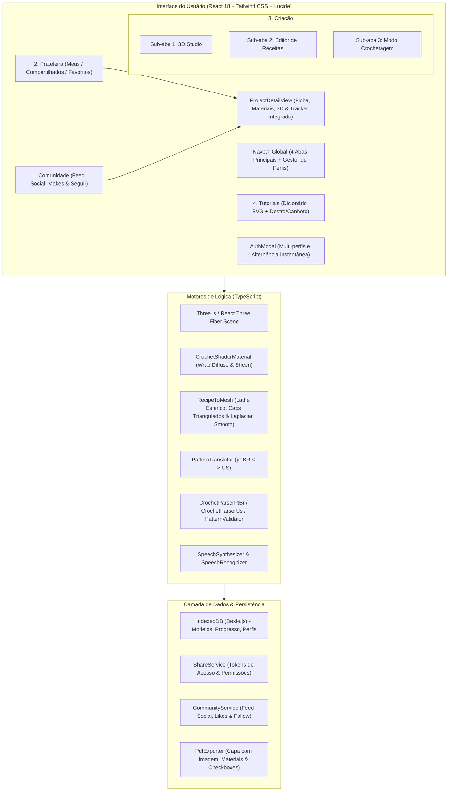

# Crochê 3D Interativo 🧶✨

<div align="center">


<p align="center">
  <b>Plataforma web avançada para modelagem tridimensional, simulação tátil de fios, conversão bidirecional de receitas de crochê, execução guiada hands-free por voz e comunidade colaborativa de artesãos.</b>
</p>

[Visão Geral](#-visão-geral) •
[Funcionalidades](#-funcionalidades-principais) •
[Arquitetura](#-arquitetura-do-sistema) •
[Começando](#-como-executar-o-projeto) •
[Estrutura de Pastas](#-estrutura-do-projeto) •
[Documentação](#-documentação-completa) •
[Licença](#-licença)

</div>

---

## 🌟 Visão Geral

O **Crochê 3D Interativo** aproxima o artesanato têxtil tradicional da computação gráfica moderna na web. A plataforma permite que artesãos, designers e entusiastas modelem peças tridimensionais (como amigurumis, roupas, bolsas e itens decorativos), visualizem a textura física aproximada dos fios em tempo real e gerem a receita escrita correspondente de forma matemática e automática.

Além da modelagem, a aplicação resolve a maior dor de quem crocheta: **acompanhar a receita com as mãos ocupadas**. Com o **Modo Crochetagem Hands-Free**, o usuário ouve as instruções por síntese de voz (TTS) em português, avança carreiras e pontos usando comandos de voz pelo microfone, visualiza um mini-mapa 3D com a carreira ativa em destaque, e pode compartilhar suas receitas em uma galeria social ou de forma privada com controle de permissões.

---

## 🚀 Funcionalidades Principais

### 1. 🌐 Comunidade & Galeria Social (Aba 1)
- **Feed Social em Destaque**: Descubra receitas públicas categorizadas (Amigurumis, Roupas, Bolsas, Casa) e filtre por nível de habilidade (Iniciante, Intermediário, Avançado).
- **Seguir Artesãos & Curtidas**: Acompanhe o trabalho dos seus criadores favoritos com contadores dinâmicos de curtidas e seguidores.
- **Mural "Feito pela Comunidade"**: Compartilhe e visualize fotos de peças físicas reais tecidas pela comunidade a partir de receitas públicas.
- **Página de Apresentação de Receita (`ProjectDetailView`)**: Clique em qualquer receita para ver fotografia da peça física, nível, tempo estimado, tabela de materiais e botões diretos para abrir no 3D Studio ou iniciar no Modo Crochetagem.

### 2. 🗄️ Prateleira de Projetos & Compartilhamento Privado (Aba 2)
- **Sub-Abas Especializadas**: Organize seus trabalhos em `Meus Projetos`, `Compartilhados Comigo` e `Favoritos`.
- **Controle Fino de Privacidade**: Alterne entre `Público` e `Privado` a qualquer instante.
- **Compartilhamento Privado Seguro**: Convide artesãos diretamente por `@handle` ou gere links com tokens criptográficos revogáveis (`viewer` ou `editor`).
- **Exportação em PDF Editorial com Imagens**: Layout profissional estilo revista com foto real de capa, ficha técnica, lista de materiais e caixas de checagem (`[ ]`) para acompanhar no papel com caneta.

### 3. 🎨 Estúdio de Criação (Aba 3)
- **Sub-Aba 1: 3D Studio**:
  - Primitivas paramétricas multi-peças (cabeça, corpo, membros, orelhas) com controle Drei `TransformControls`.
  - Shaders realistas com Wrap Diffuse, relevo de nós e textura tátil aveludada (*sheen*).
  - Geometria orgânica suave (`RecipeToMesh`) com revolução esférica, tampas trianguladas fechadas e Laplacian Smoothing.
  - Importação de malhas externas `.glb`, `.gltf` e `.obj` (até 30 MB) com decimação automática.
- **Sub-Aba 2: Editor de Receitas**:
  - Editor em texto livre e tabela visual com validação matemática em tempo real.
  - **Tradutor Bidirecional pt-BR $\leftrightarrow$ US (`PatternTranslator`)**: Tradução com um clique de vocabulário e convenções de carreira (`Carr. X:` $\leftrightarrow$ `Rnd X:`).
- **Sub-Aba 3: Modo Crochetagem (Hands-Free Tracker)**:
  - Controle de execução intencional com botão Play/Pause (o áudio TTS não dispara sozinho).
  - Gaveta retrátil lateral com visão de todas as partes e carreiras do amigurumi completo.
  - Badges clicáveis que abrem diagramas vetoriais SVG de tutoriais de pontos instantaneamente.
  - Reconhecimento contínuo de comandos por voz (*"próximo"*, *"voltar"*, *"repetir"*).
  - Mini-mapa 3D sincronizado que destaca a carreira exata sendo executada.

### 4. 📖 Tutoriais & Dicionário de Pontos com SVG Interativo (Aba 4)
- **Diagramas Vetoriais SVG**: Passo a passo visual de laçadas e inserções de agulha para todos os pontos (`am`, `corr`, `pb`, `mpa`, `pa`, `pbx`, `aum`, `dim_inv`).
- **Ergonomia para Canhotos**: Espelhamento horizontal automático dos diagramas (`scaleX(-1)`) e adaptação do sentido das carreiras baseado no perfil.
- **Calculadora de Tensão e Guia de Fios**: Tabela de correspondência de agulhas e cálculo de amostra (gauge) em centímetros.

---

## 🏛️ Arquitetura do Sistema



---

## 📁 Estrutura do Projeto

```
crochet-3d/
├── docs/                                # Documentação formal da arquitetura
│   ├── ESPECIFICACAO_TECNICA.md         # Modelos TypeScript, contratos e diagramas
│   ├── REQUISITOS_E_REGRAS_DE_NEGOCIO.md# 20 Regras de Negócio e 44 Requisitos Funcionais
│   └── research/                        # Artigos de pesquisa científica e engenharia
│       ├── MATHEMATICAL_MODELING_AND_SLICING.md
│       ├── PBR_SHADERS_AND_YARN_PHYSICS.md
│       ├── HANDS_FREE_VOICE_UX_AND_ERGONOMICS.md
│       └── DATA_ARCHITECTURE_AND_FEDERATION.md
├── plans/                               # Planejamento do projeto
│   ├── PLANO_DE_DESENVOLVIMENTO.md      # Fases 1 a 7 concluídas com testes
│   ├── PLANO_DE_REFATORACAO_E_EXPANSAO.md # Arquitetura do refactoring de UX
│   ├── PLANO_REORGANIZACAO_ABAS_E_MODO_CROCHETAGEM.md # Plano de execução detalhado
│   └── ROADMAP_FUTURO.md                # 4 Ciclos estratégicos futuros
├── src/
│   ├── assets/                          # Texturas procedurais e assets estáticos
│   ├── __tests__/                       # Suítes de testes unitários automatizados
│   │   ├── engine.test.ts               # Testes de malha 3D e fatiamento
│   │   ├── parsers.test.ts              # Testes de parsing e tradução pt-BR/US
│   │   └── store_and_tabs.test.ts       # Testes de navegação, persistência e estados
│   ├── components/
│   │   ├── layout/                      # Navbar com 5 abas, Footer e Containers
│   │   ├── auth/                        # AuthModal (Multi-perfis com troca fluida)
│   │   ├── community/                   # Galeria Pública, Cards e Perfil Público
│   │   ├── shelf/                       # Meus Projetos, Compartilhados, Modais de Acesso
│   │   ├── project/                     # ProjectDetailView (Apresentação completa da receita)
│   │   ├── learn/                       # Dicionário de Pontos, StitchSvgDiagram, Guia de Fios
│   │   ├── studio/                      # Viewport 3D, Gizmo, Primitivas, Importador
│   │   ├── pattern/                     # Editor de Texto, PatternTranslator, Validação
│   │   ├── tracker/                     # Modo Crochetagem com Play/Pause e Drawer
│   │   └── profile/                     # Perfil do Artesão, Destro/Canhoto, Badges
│   ├── core/
│   │   ├── audio/                       # SpeechSynthesizer, SpeechRecognizer, SoundEffects
│   │   ├── engine/                      # MeshSlicer, RecipeToMesh, CrochetShaderMaterial
│   │   ├── export/                      # PdfExporter com fotos e checkboxes [ ]
│   │   ├── parser/                      # CrochetParserPtBr, CrochetParserUs, PatternTranslator
│   │   ├── services/                    # ShareService, CommunityService (RLS-Ready)
│   │   └── storage/                     # Dexie.js (IndexedDB com dados pré-carregados)
│   ├── data/                            # Presets de Projetos, Comunidade, Fios e Tutoriais
│   ├── store/                           # Zustand (useCrochetStore, useProfileStore, useSocialStore)
│   ├── types/                           # Tipagens TypeScript (crochet.ts)
│   ├── App.tsx                          # Componente raiz com roteamento reativo de abas
│   └── main.tsx                         # Ponto de entrada React 18
├── package.json                         # Dependências e scripts npm
├── vite.config.ts                       # Configuração do Vite com alias @/
├── tsconfig.json                        # Configuração do TypeScript
└── tailwind.config.js                   # Configuração de temas e cores
```

---

## 🛠️ Tecnologias Utilizadas

| Tecnologia | Versão | Finalidade |
| :--- | :--- | :--- |
| **React** | 18.3+ | Biblioteca de interface reativa orientada a componentes |
| **TypeScript** | 5.5+ | Tipagem estática rigorosa para dados têxteis e matemáticos |
| **Vite** | 6.0+ | Ferramenta de build de alta performance e HMR instantâneo |
| **Three.js** | r173 | Motor gráfico 3D para renderização no navegador |
| **React Three Fiber** | 8.17+ | Renderizador Three.js declarativo em componentes React |
| **@react-three/drei** | 9.121+ | Utilitários 3D (OrbitControls, TransformControls, ContactShadows) |
| **Tailwind CSS** | 3.4+ | Framework utilitário de estilização com suporte a temas |
| **Lucide Icons** | 0.469+ | Ícones vetoriais modernos |
| **Zustand** | 5.0+ | Gerenciamento de estado global leve e desacoplado |
| **Dexie.js** | 4.0+ | Wrapper reativo para IndexedDB (persistência offline) |
| **jsPDF** | 2.5+ | Motor cliente para geração de PDFs em alta resolução |
| **Web Speech API** | Nativa | Síntese de voz em português (TTS) e comandos por microfone |
| **Vitest** | 3.2+ | Framework de testes unitários ultrarrápido |

---

## 💻 Como Executar o Projeto

### Pré-requisitos
- **Node.js**: v18.0.0 ou superior (testado e homologado no Node v22.x)
- **npm**: v9.0.0 ou superior

### Passo a Passo

1. **Clone o repositório:**
   ```bash
   git clone https://github.com/seu-usuario/crochet-3d.git
   cd crochet-3d
   ```

2. **Instale as dependências:**
   ```bash
   npm install
   ```

3. **Inicie o servidor de desenvolvimento:**
   ```bash
   npm run dev
   ```
   Acesse a aplicação no navegador em `http://localhost:5173`.

4. **Execute os testes unitários:**
   ```bash
   npm test -- --run
   ```
   > Resultado esperado: **25/25 testes passando** em 3 suítes (`parsers.test.ts`, `store_and_tabs.test.ts`, `engine.test.ts`).

5. **Gere a compilação de produção:**
   ```bash
   npm run build
   ```

6. **Visualize a compilação de produção localmente:**
   ```bash
   npm run preview
   ```

---

## 🧪 Suíte de Testes

O projeto conta com 25 testes unitários cobrindo o núcleo de lógica têxtil, matemática e gerenciamento de estado:
- **Testes de Parsers (`parsers.test.ts` - 13 testes)**: Validação de receitas em texto livre pt-BR e US, expansão de intervalos (`Carr 5-8`), grupos de repetição complexos e **tradução bidirecional pt-BR $\leftrightarrow$ US** com regex ancorada.
- **Testes de Store e Navegação (`store_and_tabs.test.ts` - 7 testes)**: Validação da hierarquia de 4 abas principais, alternância das 3 sub-abas em Criação, controle de Play/Pause e abertura de projeto diretamente no tracker.
- **Testes de Engine (`engine.test.ts` - 5 testes)**: Conservação de pontos no fatiamento radial (`MeshSlicer`), geração de malhas orgânicas com caps triangulados fechados (`RecipeToMesh`) e validação matemática de carreiras sem falsos positivos.

Para executar os testes em modo interativo de monitoramento:
```bash
npm run test:watch
```

---

## 📚 Documentação Completa e Pesquisa Técnica

Toda a base técnica, requisitos e cadernos de pesquisa científica estão documentados nas pastas [`docs/`](./docs/) e [`plans/`](./plans/):

### 📋 Especificações do Sistema e Planejamento
- 📄 [**Especificação Técnica e Arquitetura (`docs/ESPECIFICACAO_TECNICA.md`)**](./docs/ESPECIFICACAO_TECNICA.md): Modelos de dados em TypeScript, diagramas em camadas e contratos de serviços.
- 📋 [**Matriz de Requisitos e Regras de Negócio (`docs/REQUISITOS_E_REGRAS_DE_NEGOCIO.md`)**](./docs/REQUISITOS_E_REGRAS_DE_NEGOCIO.md): Matriz de 20 Regras de Negócio (RN-01 a RN-20) e 44 Requisitos Funcionais (RF-01 a RF-44).
- 🛠️ [**Plano de Desenvolvimento e Homologação (`plans/PLANO_DE_DESENVOLVIMENTO.md`)**](./plans/PLANO_DE_DESENVOLVIMENTO.md): Roteiro das 7 fases concluídas com relatório de testes (23 testes) e compilação de produção.
- 📐 [**Plano de Refatoração e Expansão (`plans/PLANO_DE_REFATORACAO_E_EXPANSAO.md`)**](./plans/PLANO_DE_REFATORACAO_E_EXPANSAO.md): Especificação dos novos componentes e correções ergonômicas.
- 🗺️ [**Roadmap Estratégico de Futuras Implementações (`plans/ROADMAP_FUTURO.md`)**](./plans/ROADMAP_FUTURO.md): 4 Ciclos futuros (IA/OCR Têxtil, App Nativo, Marketplace e Vestuário PP-XG).

### 🔬 Caderno de Pesquisa Técnica para Futuras Explorações (`docs/research/`)
- 📐 [**Modelagem Matemática e Fatiamento Têxtil (`docs/research/MATHEMATICAL_MODELING_AND_SLICING.md`)**](./docs/research/MATHEMATICAL_MODELING_AND_SLICING.md): Curvatura Gaussiana em crochê, algoritmo de fatiamento radial adaptativo e partição equiangular de laçadas.
- ✨ [**Shaders PBR e Física de Fios (`docs/research/PBR_SHADERS_AND_YARN_PHYSICS.md`)**](./docs/research/PBR_SHADERS_AND_YARN_PHYSICS.md): Óptica de fibras têxteis, síntese procedural de nós em GPU e otimizações WebGL para dispositivos móveis.
- 🎙️ [**Ergonomia, Acessibilidade e Engenharia de Voz (`docs/research/HANDS_FREE_VOICE_UX_AND_ERGONOMICS.md`)**](./docs/research/HANDS_FREE_VOICE_UX_AND_ERGONOMICS.md): Biomecânica da mão dominante, ergonomia para canhotos, máquina de estados finitos (FSM) de voz e prevenção de LER/DORT.
- 🗄️ [**Arquitetura de Dados, Direitos e Federação (`docs/research/DATA_ARCHITECTURE_AND_FEDERATION.md`)**](./docs/research/DATA_ARCHITECTURE_AND_FEDERATION.md): Formato canônico aberto `.crochet3d`, modelo de autoria imutável vs diário do maker, e políticas Supabase RLS.

---

## 📄 Licença

Este projeto está licenciado sob a licença **MIT** - consulte o arquivo [LICENSE](./LICENSE) para obter mais detalhes.

---

<div align="center">
  <sub>Criado com carinho para valorizar e modernizar a comunidade de artesãos de crochê e amigurumi ao redor do mundo. 🧶✨</sub>
</div>
