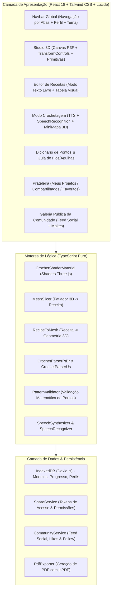

# Crochê 3D Interativo 🧶✨

<div align="center">


<p align="center">
  <b>Plataforma web avançada para modelagem tridimensional, simulação tátil de fios, conversão bidirecional de receitas de crochê, execução guiada hands-free por voz e comunidade colaborativa de artesãos.</b>
</p>

[Visão Geral](#-visão-geral) •
[Funcionalidades](#-funcionalidades-principais) •
[Arquitetura](#-arquitetura-do-sistema) •
[Começando](#-como-executar-o-projeto) •
[Estrutura de Pastas](#-estrutura-do-projeto) •
[Documentação](#-documentação-completa) •
[Licença](#-licença)

</div>

---

## 🌟 Visão Geral

O **Crochê 3D Interativo** aproxima o artesanato têxtil tradicional da computação gráfica moderna na web. A plataforma permite que artesãos, designers e entusiastas modelem peças tridimensionais (como amigurumis, roupas, bolsas e itens decorativos), visualizem a textura física aproximada dos fios em tempo real e gerem a receita escrita correspondente de forma matemática e automática.

Além da modelagem, a aplicação resolve a maior dor de quem crocheta: **acompanhar a receita com as mãos ocupadas**. Com o **Modo Crochetagem Hands-Free**, o usuário ouve as instruções por síntese de voz (TTS) em português, avança carreiras e pontos usando comandos de voz pelo microfone, visualiza um mini-mapa 3D com a carreira ativa em destaque, e pode compartilhar suas receitas em uma galeria social ou de forma privada com controle de permissões.

---

## 🚀 Funcionalidades Principais

### 1. 🧶 Studio de Modelagem 3D & Shaders PBR de Fio
- **Primitivas Paramétricas Multi-Peças**: Adicione e posicione esferas, cilindros, cápsulas, cones, cubos e toros para montar peças complexas (ex: cabeça, corpo, membros, orelhas).
- **Manipulação com Gizmo 3D**: Transformações interativas Drei (`TransformControls`) para Mover, Rotacionar e Escalar com precisão milimétrica e dimensões reais em centímetros.
- **Shaders Táteis Realistas**: Simulação de relevo de pontos entrelaçados (bump/normal procedurais), torção e pilosidade do fio (*sheen/velvet fuzziness*).
- **Catálogo de Fios Industriais**: Fio Amigurumi 100% Algodão, Chenille/Pelúcia, Lã/Acrílico e Fio de Malha, com cálculo automático de metragem (m) e peso (g) necessários.
- **Importador de Arquivos 3D**: Carregamento de malhas externas `.glb`, `.gltf` e `.obj` vindas do Blender, com detecção automática de sub-malhas e centralização.

### 2. 🔄 Motor de Conversão Bidirecional (3D $\leftrightarrow$ Receita)
- **3D $\rightarrow$ Receita (`MeshSlicer`)**:
  - *Modo Espiral/Circular*: Fatiamento radial para amigurumis a partir do Anel Mágico com aumentos radiais balanceados e diminuições suaves sem pontos órfãos.
  - *Modo Linear*: Fatiamento em planos ortogonais para peças planas, mantas e painéis de vestuário.
- **Receita $\rightarrow$ 3D (`RecipeToMesh`)**:
  - Reconstrução da geometria tridimensional em tempo real a partir de qualquer receita em texto ou montada na tabela.
- **Parser Inteligente Bilíngue**:
  - Reconhece abreviações em português (`corr`, `pb`, `pa`, `mpa`, `pbx`, `aum`, `dim`, `dim_inv`, `am`) e termos internacionais US (`ch`, `sc`, `dc`, `hdc`, `sl st`, `inc`, `dec`, `mr`).
  - Suporta intervalos de carreiras (`Carr 5-8: 24 pb`) e grupos de repetição complexos com prefixos e sufixos (`Carr 4: 2 pb, [1 pb, 1 aum] x 6, 2 pb (22)`).
- **Validador Matemático (`PatternValidator`)**:
  - Alertas visuais em tempo real indicando divergências na contagem de pontos entre voltas, com sugestões de correção matemática sem travar a renderização.

### 3. 🎙️ Modo Crochetagem Hands-Free (Live Tracker)
- **Ditado de Voz em Português (TTS)**: O app lê as instruções da carreira e do ponto ativo em voz alta via Web Speech API.
- **Reconhecimento de Voz sem as Mãos**: Comandos de voz contínuos (*"próximo"*, *"voltar"*, *"repetir"*, *"próxima carreira"*, *"carreira anterior"*) para avançar sem largar a agulha e o fio.
- **Feedback Sonoro & Celebração**: Bips suaves sintetizados via Web Audio API para confirmação auditiva sem olhar para a tela, e animação de confetes ao finalizar a peça.
- **Mini-Mapa 3D Sincronizado**: Viewport 3D em miniatura que destaca com cor contrastante e efeito visual exatamente a carreira física que está sendo executada.
- **Ajuda Rápida de Pontos `?`**: Acesso direto ao tutorial do ponto com um clique, sem perder o progresso da carreira.

### 4. 👤 Perfil do Artesão, Ergonomia & Gamificação
- **Ergonomia por Mão Dominante (Destro / Canhoto)**: Adaptação da ordem de leitura de carreiras circulares e espelhamento das instruções e animações de laçadas nos tutoriais.
- **Tensão Pessoal de Ponto (Amostra / Gauge)**: Calibração manual da tensão do ponto para estimativas exatas de medidas em centímetros.
- **Diário de Execução (Maker Journal)**: Registro de datas de início e término, agulha/fio utilizados, anotações de tecelagem e anexo de fotos reais da peça física tecida.
- **Painel de Estatísticas & Conquistas**: Contador acumulado de pontos tecidos, metros de fio consumidos e galeria de insígnias comemorativas.

### 5. 🔒 Privacidade, Compartilhamento & Galeria da Comunidade
- **Controle de Visibilidade**: Alternador por projeto entre `Público` e `Privado`.
- **Compartilhamento Privado Seguro**: Geração de link com token criptográfico revogável ou convite direto por `@handle`, com níveis de permissão configuráveis:
  - *Visualizador/Maker*: Apenas visualiza em 3D e acompanha no Modo Crochetagem com progresso individual isolado.
  - *Co-autor/Editor*: Permissão colaborativa para editar a receita.
  - Opção de liberar ou bloquear o download em PDF.
- **Sub-Aba 'Compartilhados Comigo'**: Área dedicada para acessar e resgatar projetos privados compartilhados por outros artesãos.
- **Galeria Social da Comunidade**: Feed público com filtros por categoria (Amigurumi, Roupas, Bolsas, Casa), ordenação por popularidade e sistema para **Seguir Artesãos**.
- **Mural "Feito pela Comunidade"**: Espaço onde quem teceu a receita pública de um designer pode postar fotos reais do seu trabalho.
- **Exportação de PDF Estilo Revista**: Diagramação profissional com capa 3D em alta resolução, ficha de materiais, abreviações, instruções por partes e créditos imutáveis do designer.

---

## 🏛️ Arquitetura do Sistema



---

## 📁 Estrutura do Projeto

```
crochet-3d/
├── docs/                                # Documentação formal da arquitetura
│   ├── ESPECIFICACAO_TECNICA.md         # Modelos TypeScript, contratos e diagramas
│   └── REQUISITOS_E_REGRAS_DE_NEGOCIO.md# Matriz formal de RF, RN, RNF e Restrições
├── plans/                               # Planejamento do projeto
│   └── PLANO_DE_DESENVOLVIMENTO.md      # Roteiro de desenvolvimento detalhado
├── src/
│   ├── assets/                          # Texturas procedurais e assets estáticos
│   ├── components/
│   │   ├── layout/                      # Navbar, Footer e Containers
│   │   ├── studio/                      # Viewport 3D, Gizmo, Primitivas, Importador
│   │   ├── pattern/                     # Editor de Texto Livre, Tabela Visual, Validação
│   │   ├── tracker/                     # Modo Crochetagem, Mini-Mapa 3D, Botão ? de Ajuda
│   │   ├── learn/                       # Dicionário de Pontos, Guia de Fios e Agulhas
│   │   ├── shelf/                       # Meus Projetos, Compartilhados Comigo, Modal de Compartilhar
│   │   ├── community/                   # Galeria Pública, Mural Makes, Botão Seguir
│   │   └── profile/                     # Perfil do Artesão, Destro/Canhoto, Badges
│   ├── core/
│   │   ├── audio/                       # SpeechSynthesizer, SpeechRecognizer, SoundEffects
│   │   ├── engine/                      # MeshSlicer, RecipeToMesh, CrochetShaderMaterial
│   │   ├── export/                      # PdfExporter, ProjectFileIO (.crochet3d)
│   │   ├── parser/                      # CrochetParserPtBr, CrochetParserUs, PatternValidator
│   │   ├── services/                    # ShareService, CommunityService (RLS-Ready)
│   │   └── storage/                     # Dexie.js (IndexedDB com projetos pré-carregados)
│   ├── data/                            # Presets de Projetos, Comunidade, Fios e Tutoriais
│   ├── store/                           # Stores Zustand (useCrochetStore, useProfileStore, useSocialStore)
│   ├── types/                           # Tipagens TypeScript (crochet.ts)
│   ├── App.tsx                          # Componente raiz com roteamento reativo de abas
│   └── main.tsx                         # Ponto de entrada React 18
├── package.json                         # Dependências e scripts npm
├── vite.config.ts                       # Configuração do Vite com alias @/
├── tsconfig.json                        # Configuração do TypeScript
└── tailwind.config.js                   # Configuração de temas e cores
```

---

## 🛠️ Tecnologias Utilizadas

| Tecnologia | Versão | Finalidade |
| :--- | :--- | :--- |
| **React** | 18.3+ | Biblioteca de interface reativa orientada a componentes |
| **TypeScript** | 5.5+ | Tipagem estática rigorosa para dados têxteis e matemáticos |
| **Vite** | 6.0+ | Ferramenta de build de alta performance e HMR instantâneo |
| **Three.js** | r173 | Motor gráfico 3D para renderização no navegador |
| **React Three Fiber** | 8.17+ | Renderizador Three.js declarativo em componentes React |
| **@react-three/drei** | 9.121+ | Utilitários 3D (OrbitControls, TransformControls, ContactShadows) |
| **Tailwind CSS** | 3.4+ | Framework utilitário de estilização com suporte a temas |
| **Lucide Icons** | 0.469+ | Ícones vetoriais modernos |
| **Zustand** | 5.0+ | Gerenciamento de estado global leve e desacoplado |
| **Dexie.js** | 4.0+ | Wrapper reativo para IndexedDB (persistência offline) |
| **jsPDF** | 2.5+ | Motor cliente para geração de PDFs em alta resolução |
| **Web Speech API** | Nativa | Síntese de voz em português (TTS) e comandos por microfone |
| **Vitest** | 3.2+ | Framework de testes unitários ultrarrápido |

---

## 💻 Como Executar o Projeto

### Pré-requisitos
- **Node.js**: v18.0.0 ou superior (testado e homologado no Node v22.x)
- **npm**: v9.0.0 ou superior

### Passo a Passo

1. **Clone o repositório:**
   ```bash
   git clone https://github.com/seu-usuario/crochet-3d.git
   cd crochet-3d
   ```

2. **Instale as dependências:**
   ```bash
   npm install
   ```

3. **Inicie o servidor de desenvolvimento:**
   ```bash
   npm run dev
   ```
   Acesse a aplicação no navegador em `http://localhost:5173`.

4. **Execute os testes unitários:**
   ```bash
   npm test
   ```

5. **Gere a compilação de produção:**
   ```bash
   npm run build
   ```

6. **Visualize a compilação de produção localmente:**
   ```bash
   npm run preview
   ```

---

## 🧪 Suíte de Testes

O projeto conta com testes unitários cobrindo o núcleo de lógica têxtil e matemática:
- **Testes de Parsers (`parsers.test.ts`)**: Validação de receitas em texto livre pt-BR e US, expansão de intervalos (`Carr 5-8`) e grupos de repetição com prefixo e sufixo.
- **Testes de Engine (`engine.test.ts`)**: Validação de conservação de pontos no fatiamento radial (`MeshSlicer`), detecção de anel mágico e validação matemática de carreiras sem falsos positivos.

Para executar os testes em modo contínuo ou com cobertura:
```bash
npm run test:watch
```

---

## 📚 Documentação Completa e Pesquisa Técnica

Toda a base técnica, requisitos e cadernos de pesquisa científica estão documentados nas pastas [`docs/`](./docs/) e [`plans/`](./plans/):

### 📋 Especificações do Sistema e Planejamento
- 📄 [**Especificação Técnica e Arquitetura (`docs/ESPECIFICACAO_TECNICA.md`)**](./docs/ESPECIFICACAO_TECNICA.md): Modelos de dados em TypeScript, diagramas em camadas e contratos de serviços.
- 📋 [**Matriz de Requisitos e Regras de Negócio (`docs/REQUISITOS_E_REGRAS_DE_NEGOCIO.md`)**](./docs/REQUISITOS_E_REGRAS_DE_NEGOCIO.md): Matriz de 15 Regras de Negócio (RN-01 a RN-15) e 38 Requisitos Funcionais (RF-01 a RF-38).
- 🛠️ [**Plano de Desenvolvimento e Homologação (`plans/PLANO_DE_DESENVOLVIMENTO.md`)**](./plans/PLANO_DE_DESENVOLVIMENTO.md): Roteiro das 6 fases concluídas com relatório de testes e compilação.
- 🗺️ [**Roadmap Estratégico de Futuras Implementações (`plans/ROADMAP_FUTURO.md`)**](./plans/ROADMAP_FUTURO.md): 4 Ciclos futuros (IA/OCR Têxtil, App Nativo nas Lojas, Marketplace de Designers e Vestuário PP-XG).

### 🔬 Caderno de Pesquisa Técnica para Futuras Explorações (`docs/research/`)
- 📐 [**Modelagem Matemática e Fatiamento Têxtil (`docs/research/MATHEMATICAL_MODELING_AND_SLICING.md`)**](./docs/research/MATHEMATICAL_MODELING_AND_SLICING.md): Curvatura Gaussiana em crochê, algoritmo de fatiamento radial adaptativo e partição equiangular de laçadas.
- ✨ [**Shaders PBR e Física de Fios (`docs/research/PBR_SHADERS_AND_YARN_PHYSICS.md`)**](./docs/research/PBR_SHADERS_AND_YARN_PHYSICS.md): Óptica de fibras têxteis, síntese procedural de nós em GPU e otimizações WebGL para dispositivos móveis.
- 🎙️ [**Ergonomia, Acessibilidade e Engenharia de Voz (`docs/research/HANDS_FREE_VOICE_UX_AND_ERGONOMICS.md`)**](./docs/research/HANDS_FREE_VOICE_UX_AND_ERGONOMICS.md): Biomecânica da mão dominante, ergonomia para canhotos, máquina de estados finitos (FSM) de voz e prevenção de LER/DORT.
- 🗄️ [**Arquitetura de Dados, Direitos e Federação (`docs/research/DATA_ARCHITECTURE_AND_FEDERATION.md`)**](./docs/research/DATA_ARCHITECTURE_AND_FEDERATION.md): Formato canônico aberto `.crochet3d`, modelo de autoria imutável vs diário do maker, e políticas Supabase RLS.

---

## 📄 Licença

Este projeto está licenciado sob a licença **MIT** - consulte o arquivo de licença para obter mais detalhes.

---

<div align="center">
  <sub>Criado com carinho para valorizar e modernizar a comunidade de artesãos de crochê e amigurumi ao redor do mundo. 🧶✨</sub>
</div>
