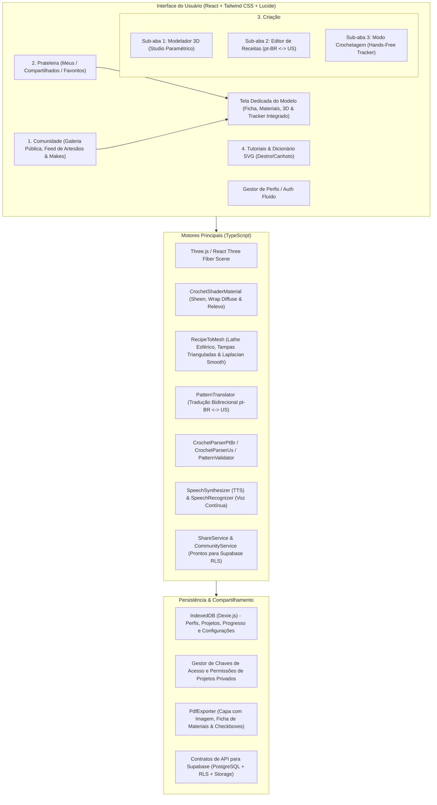

# Especificação Técnica e Arquitetura: Crochê 3D Interativo

Um aplicativo web interativo para modelagem 3D, conversão bidirecional de receitas de crochê, renderização realista com física de fios, execução guiada no "Modo Crochetagem" com comando por voz, perfil do artesão, galeria pública da comunidade e compartilhamento privado.

---

## 1. Visão Geral do Sistema e Arquitetura



---

## 2. Decisões Arquiteturais Definidas no Alinhamento

| Área | Decisão Selecionada | Justificativa |
| :--- | :--- | :--- |
| **Stack Base** | React 18/19 + Vite + TypeScript + Tailwind CSS | Alta velocidade de compilação, modularidade e estabilidade. |
| **Hierarquia de Navegação** | 4 Abas Principais (`1. Comunidade` -> `2. Prateleira` -> `3. Criação` -> `4. Tutoriais`) | Fluxo de navegação limpo, removendo abas órfãs e centralizando a execução no modelo ativo. |
| **Criação Unificada (3 Sub-Abas)** | Aba `Criação` com 3 sub-abas: `3D Studio`, `Editor de Receitas` e `Modo Crochetagem` | Unifica o ciclo de vida criativo completo (modelar, escrever e tecer) em uma única aba de trabalho. |
| **Apresentação de Receitas** | Tela Dedicada de Detalhes (`ProjectDetailView`) com Tracker Integrado | Centraliza a foto da peça física, lista de ingredientes/materiais e permite entrar diretamente no Modo Crochetagem. |
| **Motor Gráfico 3D** | Three.js + React Three Fiber (`@react-three/fiber`, `@react-three/drei`) | Controle declarativo de cena, suporte nativo a transformações, câmeras e Shaders. |
| **Geometria de Amigurumi** | Revolução Esférica com Tampas em Leque e Laplacian Smoothing (`RecipeToMesh`) | Elimina pontas abertas e afunilamentos deformados, gerando malhas orgânicas e fechadas para peças circulares. |
| **Renderização do Fio** | Shading de Fio com Wrap Diffuse e Micro-Weave Sheen (`CrochetShaderMaterial`) | Simula a maciez tátil de fios de algodão e chenille sem comprometer a taxa de quadros (60 FPS). |
| **Tradução pt-BR $\leftrightarrow$ US** | Tradutor Bidirecional com Ancoragem de Regex (`PatternTranslator`) | Converte receitas com segurança matemática entre convenções brasileiras e internacionais. |
| **Diagramas de Pontos** | Diagramas Vetoriais SVG Interativos com Espelhamento para Canhotos | Ilustra visualmente o passo a passo de cada laçada de agulha com suporte ergonômico instantâneo. |
| **Modo Crochetagem** | Execução Controlada por Play/Pause, Drawer Completo e Dicionário em Popover | O áudio não dispara sem consentimento; a artesã pode saltar entre carreiras e inspecionar pontos com 1 clique. |
| **Exportação em PDF** | Layout Editorial de Revista com Foto Real e Checkboxes de Impressão (`[ ]`) | Permite acompanhamento tátil no papel com acabamento visual pronto para venda ou arquivamento. |
| **Autenticação e Perfis** | Gestão de Perfis Locais com Alternador Imediato e Preparação para Supabase Auth | Elimina bloqueios no primeiro uso, permitindo criar e alternar artesãos instantaneamente no navegador. |

---

## 3. Modelo de Dados Principal (TypeScript Types)

```typescript
// Abas Principais e Sub-Abas de Navegação
export type MainTab = 'community' | 'shelf' | 'creation' | 'learn';
export type CreationSubTab = 'studio' | 'pattern' | 'tracker';

// Estrutura de um Ponto de Crochê
export type StitchType = 
  | 'corr'    // correntinha (ch)
  | 'pb'      // ponto baixo (sc)
  | 'pa'      // ponto alto (dc)
  | 'mpa'     // meio ponto alto (hdc)
  | 'pbx'     // ponto baixíssimo (sl st)
  | 'pad'     // ponto alto duplo (tr)
  | 'aum'     // aumento (inc)
  | 'dim'     // diminuição (dec)
  | 'dim_inv' // diminuição invisível
  | 'am';     // anel mágico (magic ring)

// Passo a Passo com Diagrama Vetorial SVG
export interface StitchTutorialStep {
  stepNumber: number;
  title: string;
  description: string;
  svgDiagramId?: string; // ID do diagrama SVG paramétrico
}

export interface StitchTutorial {
  id: StitchType;
  namePt: string;
  nameUs: string;
  abbrevPt: string;
  abbrevUs: string;
  description: string;
  difficulty: 'iniciante' | 'intermediario' | 'avancado';
  steps: StitchTutorialStep[];
  tips: string[];
}

// Perfil do Usuário / Artesão
export interface ArtisanProfile {
  id: string;
  name: string;
  handle: string; // ex: '@maria_amigurumi'
  avatarUrl?: string;
  bio?: string;
  dominantHand: 'right' | 'left'; // Destro ou Canhoto
  skillLevel: 'beginner' | 'intermediate' | 'advanced';
  tensionCalibration: {
    customGaugeEnabled: boolean;
    stitchesPer10cm: number;
    rowsPer10cm: number;
  };
  socialLinks?: {
    instagram?: string;
    website?: string;
  };
  stats: {
    totalStitchesCrocheted: number;
    totalMetersUsed: number;
    completedProjectsCount: number;
    followersCount: number;
    followingCount: number;
    earnedBadges: string[];
  };
  createdAt: number;
  updatedAt: number;
}

// Nível de Permissão para Projetos Compartilhados Privados
export type SharePermissionLevel = 'viewer' | 'editor';

// Registro de Compartilhamento de Projeto Privado
export interface ProjectShareEntry {
  id: string;
  projectId: string;
  granteeUserId?: string;      // ID do artesão autorizado
  granteeHandle?: string;      // @handle do artesão
  permission: SharePermissionLevel;
  allowPdfDownload: boolean;
  accessToken?: string;        // Chave/Token para link seguro
  createdAt: number;
}

// Licença e Direitos Autorais da Receita
export interface ProjectLicense {
  allowSellingFinishedItems: boolean; // Permitido vender a peça física
  allowSharingPattern: boolean;       // Permitido redistribuir a receita
  licenseText: string;
}

// Diário de Execução do Artesão (Maker Journal)
export interface MakerJournal {
  userId: string;
  userHandle: string;
  startedAt?: number;
  finishedAt?: number;
  notes?: string;
  hookUsedMm?: number;
  customYarnUsed?: string;
  realPhotos?: string[]; // Fotos da peça física pronta
}

// Foto enviada pela Comunidade ("Feito pela Comunidade")
export interface CommunityMake {
  id: string;
  projectId: string;
  makerId: string;
  makerName: string;
  makerHandle: string;
  makerAvatar?: string;
  photoUrl: string;
  notes?: string;
  createdAt: number;
  likesCount: number;
}

// Instrução de uma Carreira
export interface PatternRow {
  rowNumber: number;
  instructionText: string;
  stitchCount: number;
  type: 'round' | 'linear';
  stitches: {
    type: StitchType;
    count: number;
    color?: string;
  }[];
  notes?: string;
}

// Peça individual do Projeto (ex: Cabeça, Braço Direito, Corpo)
export interface ProjectPart {
  id: string;
  name: string;
  color: string;
  yarnTypeId: string;
  hookSizeMm: number;
  primitiveType?: 'sphere' | 'cylinder' | 'capsule' | 'cone' | 'box' | 'imported';
  transform: {
    position: [number, number, number];
    rotation: [number, number, number];
    scale: [number, number, number];
  };
  rows: PatternRow[];
}

// Especificação de Fio
export interface YarnSpecification {
  id: string;
  name: string;
  type: 'cotton' | 'chenille' | 'wool' | 'tshirt';
  diameterMm: number;
  tex?: number;
  roughness: number;
  fuzziness: number;
  defaultHookMm: number;
}

// Projeto Completo com Visibilidade, Galeria e Estimativas
export interface CrochetProject {
  id: string;
  title: string;
  description?: string;
  category: 'amigurumi' | 'clothing' | 'bags' | 'home' | 'other';
  difficulty: 'beginner' | 'intermediate' | 'advanced';
  visibility: 'private' | 'public';
  createdAt: number;
  updatedAt: number;
  thumbnailUrl?: string;
  galleryPhotos?: string[];          // Fotos reais de demonstração da peça
  totalStitchesEstimated?: number;   // Contagem estimada de pontos do projeto
  
  // Metadados de Autoria (Designer Original)
  designer: {
    userId: string;
    name: string;
    handle: string;
    avatarUrl?: string;
    license: ProjectLicense;
  };

  // Diário de Execução do Usuário Atual (Maker)
  journal: MakerJournal;

  // Compartilhamentos Privados (se visibility === 'private')
  sharedWith: ProjectShareEntry[];

  // Engajamento Social (se visibility === 'public')
  social: {
    likesCount: number;
    isLikedByCurrentUser?: boolean;
    isBookmarkedByCurrentUser?: boolean;
    makesCount: number;
  };

  parts: ProjectPart[];
  materials: {
    yarns: { yarnId: string; color: string; estimatedMeters: number; estimatedGrams: number }[];
    hooks: number[];
    accessories: string[];
  };
  progress: {
    activePartId: string;
    currentRowIndex: number;
    currentStitchIndex: number;
    completedPercentage: number;
  };
}
```

---

## 4. Estrutura Modular de Pastas da Aplicação

```
crochet-3d/
├── index.html
├── package.json
├── tsconfig.json
├── vite.config.ts
├── tailwind.config.js
├── docs/
│   ├── ESPECIFICACAO_TECNICA.md
│   ├── REQUISITOS_E_REGRAS_DE_NEGOCIO.md
│   └── research/
│       ├── ALGORITMOS_DE_CONVERSAO_3D_CROCHE.md
│       ├── SHADERS_PBR_TEXTURAS_TATEIS_FIOS.md
│       └── SISTEMAS_DE_VOZ_HANDS_FREE_WEB.md
├── plans/
│   └── PLANO_DE_DESENVOLVIMENTO.md
├── src/
│   ├── main.tsx
│   ├── App.tsx
│   ├── __tests__/
│   │   ├── engine.test.ts             # Testes de fatiamento e reconstrução 3D
│   │   └── parsers.test.ts            # Testes de parsing pt-BR, US e tradução
│   ├── assets/
│   │   └── textures/                  # Texturas base de fios e normais PBR
│   ├── components/
│   │   ├── layout/
│   │   │   ├── Navbar.tsx             # 4 Abas: Comunidade, Prateleira, Criação, Tutoriais
│   │   │   └── Footer.tsx
│   │   ├── auth/
│   │   │   └── AuthModal.tsx          # Gestor de multi-perfis com alternância instantânea
│   │   ├── community/                 # Aba 1: Galeria Pública da Comunidade
│   │   │   ├── CommunityGalleryView.tsx  # Feed categorizado com busca e ordenação
│   │   │   ├── CommunityProjectCard.tsx  # Card com foto, autor, curtidas e botão de detalhes
│   │   │   └── PublicArtisanProfileModal.tsx # Perfil público do criador com seus modelos
│   │   ├── shelf/                     # Aba 2: Prateleira de Projetos
│   │   │   ├── ProjectShelfView.tsx      # Sub-abas: Meus Projetos / Compartilhados / Favoritos
│   │   │   ├── ProjectCard.tsx           # Card com capa, badges e atalho para detalhes
│   │   │   ├── ShareAccessModal.tsx      # Modal de permissões privadas (@handle ou token)
│   │   │   └── RedeemTokenModal.tsx      # Resgate de link/chave de acesso
│   │   ├── project/
│   │   │   └── ProjectDetailView.tsx     # Tela completa de receita: foto, materiais, 3D e tracker integrado
│   │   ├── studio/                    # Aba 3 (Sub-aba 1 de Criação): Modelador 3D Paramétrico
│   │   │   ├── Viewport3D.tsx            # Viewport Three.js com iluminação de estúdio
│   │   │   ├── PrimitiveControls.tsx     # Adição de primitivas paramétricas em centímetros
│   │   │   ├── TransformGizmo.tsx        # Gizmo de Mover, Rotacionar e Escalar
│   │   │   ├── PartsList.tsx             # Lista de peças (duplicar, colorir, ocultar, deletar)
│   │   │   └── ImportModal.tsx           # Importação de GLB/GLTF/OBJ com decimação automática
│   │   ├── pattern/                   # Aba 3 (Sub-aba 2 de Criação): Editor e Tradutor de Receitas
│   │   │   ├── PatternTextEditor.tsx     # Editor de texto com tradução automática pt-BR <-> US
│   │   │   ├── PatternRowTable.tsx       # Tabela visual carreira a carreira com validação
│   │   │   └── ValidationBadge.tsx       # Alertas de discrepância matemática de pontos
│   │   ├── tracker/                   # Modo Crochetagem (Sub-aba 3 de Criação & Tela Integrada do Modelo)
│   │   │   ├── LiveTrackerView.tsx       # Execução guiada com Play/Pause, drawer e badges clicáveis
│   │   │   ├── MiniMap3D.tsx             # Miniatura 3D sincronizada com carreira destacada
│   │   │   └── VoiceController.tsx       # Indicador de escuta do microfone e comandos de voz
│   │   ├── learn/                     # Aba 4: Tutoriais & Dicionário de Pontos
│   │   │   ├── StitchDictionary.tsx      # Dicionário com busca rápida e filtro por nível
│   │   │   ├── StitchSvgDiagram.tsx      # Diagramas vetoriais SVG com espelhamento para canhotos
│   │   │   └── YarnNeedleGuide.tsx       # Tabela de compatibilidade de fios, agulhas e amostra
│   │   └── profile/
│   │       └── ProfileModal.tsx          # Edição de perfil, mão dominante e estatísticas
│   ├── core/
│   │   ├── engine/
│   │   │   ├── MeshSlicer.ts             # 3D -> Fatiamento em Carreiras radiais e lineares
│   │   │   ├── RecipeToMesh.ts           # Receita -> Geometria com Lathe esférico e tampas fechadas
│   │   │   └── CrochetShaderMaterial.ts  # Shaders procedurais com Wrap Diffuse e Micro-Weave Sheen
│   │   ├── parser/
│   │   │   ├── CrochetParserPtBr.ts      # Parser de abreviações e repetições pt-BR
│   │   │   ├── CrochetParserUs.ts        # Parser de abreviações e repetições US
│   │   │   ├── PatternTranslator.ts      # Tradutor bidirecional pt-BR <-> US com regex ancorada
│   │   │   └── PatternValidator.ts       # Validação matemática de aumentos e diminuições
│   │   ├── audio/
│   │   │   ├── SpeechSynthesizer.ts      # Ditado TTS em português com controle de pitch e velocidade
│   │   │   ├── SpeechRecognizer.ts       # Reconhecimento contínuo de voz Web Speech API
│   │   │   └── SoundEffects.ts           # Feedback sonoro via Web Audio API e celebração com confetes
│   │   ├── services/
│   │   │   ├── ShareService.ts           # Gestão de permissões, links seguros e tokens de projetos privados
│   │   │   └── CommunityService.ts       # Feed da comunidade, curtidas, seguidores e makes
│   │   ├── export/
│   │   │   └── PdfExporter.ts            # PDF profissional com foto de capa, materiais e checkboxes [ ]
│   │   └── storage/
│   │       └── db.ts                     # Dexie.js (IndexedDB local com pré-carregamento de presets)
│   ├── data/
│   │   ├── presetProjects.ts             # Amigurumis pré-carregados (Polvo, Coração, Gorro, Bolsa)
│   │   ├── communityPresets.ts           # Projetos públicos e perfis de artesãos da comunidade
│   │   ├── yarnPresets.ts                # Catálogo técnico de fios (Algodão, Chenille, Lã, Malha)
│   │   └── tutorialDatabase.ts           # Base de dados de pontos com passos, ilustrações e dicas
│   └── store/
│       ├── useCrochetStore.ts            # Estado global (aba ativa, projeto, editor, tracker e Play/Pause)
│       ├── useProfileStore.ts            # Perfil do artesão, mão dominante, calibração e estatísticas
│       └── useSocialStore.ts             # Artesãos seguidos, curtidas e projetos privados compartilhados
```
