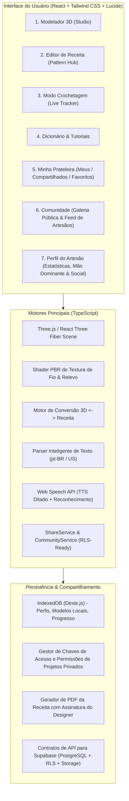

# Especificação Técnica e Arquitetura: Crochê 3D Interativo

Um aplicativo web interativo para modelagem 3D, conversão bidirecional de receitas de crochê, renderização realista com física de fios, execução guiada no "Modo Crochetagem" com comando por voz, perfil do artesão, galeria pública da comunidade e compartilhamento privado.

---

## 1. Visão Geral do Sistema e Arquitetura



---

## 2. Decisões Arquiteturais Definidas no Alinhamento

| Área | Decisão Selecionada | Justificativa |
| :--- | :--- | :--- |
| **Stack Base** | React 18/19 + Vite + TypeScript + Tailwind CSS | Alta velocidade de compilação, modularidade e estabilidade. |
| **Motor Gráfico 3D** | Three.js + React Three Fiber (`@react-three/fiber`, `@react-three/drei`) | Controle declarativo de cena, suporte nativo a transformações, câmeras e Shaders. |
| **Renderização do Crochê** | Abordagem Híbrida: Malha segmentada por carreiras/pontos + Shaders PBR com Bump/Normal Map de fios | Altíssima performance no browser permitindo destacar a carreira/ponto ativo em tempo real. |
| **3D -> Receita** | Suporte Duplo: Espiral/Circular (Amigurumis/bolsas) e Linear (peças planas/roupas) | Flexibilidade para cobrir qualquer tipo de trabalho de crochê com cálculo de aumentos/diminuições. |
| **Receita -> 3D** | Parser Inteligente de Texto (pt-BR e US) + Editor Visual Carreira a Carreira | Aceita receitas copiadas da internet e permite ajustes finos com contagem automática de pontos. |
| **Modelagem 3D** | Primitivas Paramétricas Multi-Peças (Cabeça, Corpo, etc.) + Importador GLB/GLTF/OBJ | Organização idêntica ao crochê real, onde peças são feitas individualmente e costuradas. |
| **Modo Crochetagem** | Ditado de Voz (TTS) + Comandos Hands-free ("Próximo", "Voltar") + Botões/Teclado | O artesão pode crochetar com as mãos ocupadas sem precisar tocar no celular/computador. |
| **Visibilidade de Projetos** | Suporte a Projetos Públicos e Privados com Controle Fino de Permissões | Permite publicar na comunidade ou restringir a visualização/co-autoria para convidados autorizados. |
| **Compartilhamento Privado** | Link Seguro com Token Revogável + Convite por @Handle do Artesão | Concede permissão configurável (`viewer` ou `editor`) e lista projetos na aba 'Compartilhados Comigo'. |
| **Galeria da Comunidade** | Feed Público Social com Filtros, Botão Seguir, Curtidas e 'Feito pela Comunidade' | Promove a interação entre criadores e executantes, com fotos de peças reais postadas pela comunidade. |
| **Navegação de Projetos** | Sub-Abas na Prateleira ('Meus', 'Compartilhados', 'Favoritos') + Aba 'Comunidade' no Menu | Organização limpa e intuitiva idêntica aos padrões de aplicativos modernos. |
| **Camada de Serviços** | Camada Modular (`CommunityService` e `ShareService`) pronta para Supabase RLS | Teste imediato no navegador com dados reativos e arquitetura desacoplada para nuvem real. |

---

## 3. Modelo de Dados Principal (TypeScript Types)

```typescript
// Estrutura de um Ponto de Crochê
export type StitchType = 
  | 'corr'    // correntinha (ch)
  | 'pb'      // ponto baixo (sc)
  | 'pa'      // ponto alto (dc)
  | 'mpa'     // meio ponto alto (hdc)
  | 'pbx'     // ponto baixíssimo (sl st)
  | 'pad'     // ponto alto duplo (tr)
  | 'aum'     // aumento (inc)
  | 'dim'     // diminuição (dec)
  | 'dim_inv' // diminuição invisível
  | 'am';     // anel mágico (magic ring)

// Perfil do Usuário / Artesão
export interface ArtisanProfile {
  id: string;
  name: string;
  handle: string; // ex: '@maria_amigurumi'
  avatarUrl?: string;
  bio?: string;
  dominantHand: 'right' | 'left'; // Destro ou Canhoto
  skillLevel: 'beginner' | 'intermediate' | 'advanced';
  tensionCalibration: {
    customGaugeEnabled: boolean;
    stitchesPer10cm: number;
    rowsPer10cm: number;
  };
  socialLinks?: {
    instagram?: string;
    website?: string;
  };
  stats: {
    totalStitchesCrocheted: number;
    totalMetersUsed: number;
    completedProjectsCount: number;
    followersCount: number;
    followingCount: number;
    earnedBadges: string[];
  };
  createdAt: number;
  updatedAt: number;
}

// Nível de Permissão para Projetos Compartilhados Privados
export type SharePermissionLevel = 'viewer' | 'editor';

// Registro de Compartilhamento de Projeto Privado
export interface ProjectShareEntry {
  id: string;
  projectId: string;
  granteeUserId?: string;      // ID do artesão autorizado
  granteeHandle?: string;      // @handle do artesão
  permission: SharePermissionLevel;
  allowPdfDownload: boolean;
  accessToken?: string;        // Chave/Token para link seguro
  createdAt: number;
}

// Licença e Direitos Autorais da Receita
export interface ProjectLicense {
  allowSellingFinishedItems: boolean; // Permitido vender a peça física
  allowSharingPattern: boolean;       // Permitido redistribuir a receita
  licenseText: string;
}

// Diário de Execução do Artesão (Maker Journal)
export interface MakerJournal {
  userId: string;
  userHandle: string;
  startedAt?: number;
  finishedAt?: number;
  notes?: string;
  hookUsedMm?: number;
  customYarnUsed?: string;
  realPhotos?: string[]; // Fotos da peça física pronta
}

// Foto enviada pela Comunidade ("Feito pela Comunidade")
export interface CommunityMake {
  id: string;
  projectId: string;
  makerId: string;
  makerName: string;
  makerHandle: string;
  makerAvatar?: string;
  photoUrl: string;
  notes?: string;
  createdAt: number;
  likesCount: number;
}

// Instrução de uma Carreira
export interface PatternRow {
  rowNumber: number;
  instructionText: string;
  stitchCount: number;
  type: 'round' | 'linear';
  stitches: {
    type: StitchType;
    count: number;
    color?: string;
  }[];
  notes?: string;
}

// Peça individual do Projeto (ex: Cabeça, Braço Direito, Corpo)
export interface ProjectPart {
  id: string;
  name: string;
  color: string;
  yarnTypeId: string;
  hookSizeMm: number;
  primitiveType?: 'sphere' | 'cylinder' | 'capsule' | 'cone' | 'box' | 'imported';
  transform: {
    position: [number, number, number];
    rotation: [number, number, number];
    scale: [number, number, number];
  };
  rows: PatternRow[];
}

// Especificação de Fio
export interface YarnSpecification {
  id: string;
  name: string;
  type: 'cotton' | 'chenille' | 'wool' | 'tshirt';
  diameterMm: number;
  tex?: number;
  roughness: number;
  fuzziness: number;
  defaultHookMm: number;
}

// Projeto Completo com Visibilidade e Compartilhamento
export interface CrochetProject {
  id: string;
  title: string;
  description?: string;
  category: 'amigurumi' | 'clothing' | 'bags' | 'home' | 'other';
  difficulty: 'beginner' | 'intermediate' | 'advanced';
  visibility: 'private' | 'public';
  createdAt: number;
  updatedAt: number;
  thumbnailUrl?: string;
  
  // Metadados de Autoria (Designer Original)
  designer: {
    userId: string;
    name: string;
    handle: string;
    avatarUrl?: string;
    license: ProjectLicense;
  };

  // Diário de Execução do Usuário Atual (Maker)
  journal: MakerJournal;

  // Compartilhamentos Privados (se visibility === 'private')
  sharedWith: ProjectShareEntry[];

  // Engajamento Social (se visibility === 'public')
  social: {
    likesCount: number;
    isLikedByCurrentUser?: boolean;
    isBookmarkedByCurrentUser?: boolean;
    makesCount: number;
  };

  parts: ProjectPart[];
  materials: {
    yarns: { yarnId: string; color: string; estimatedMeters: number; estimatedGrams: number }[];
    hooks: number[];
    accessories: string[];
  };
  progress: {
    activePartId: string;
    currentRowIndex: number;
    currentStitchIndex: number;
    completedPercentage: number;
  };
}
```

---

## 4. Estrutura Modular de Pastas Proposta

```
crochet-3d/
├── index.html
├── package.json
├── tsconfig.json
├── vite.config.ts
├── tailwind.config.js
├── docs/
│   ├── ESPECIFICACAO_TECNICA.md
│   └── REQUISITOS_E_REGRAS_DE_NEGOCIO.md
├── src/
│   ├── main.tsx
│   ├── App.tsx
│   ├── assets/
│   │   └── textures/          # Texturas base de fios e normais PBR
│   ├── components/
│   │   ├── layout/
│   │   │   ├── Navbar.tsx     # Menu com abas: Studio, Editor, Tracker, Learn, Projetos, Comunidade
│   │   │   └── Footer.tsx
│   │   ├── studio/            # Aba 1: Modelador 3D & Transformações
│   │   │   ├── Viewport3D.tsx
│   │   │   ├── PrimitiveControls.tsx
│   │   │   ├── PartsList.tsx
│   │   │   └── ImportModal.tsx
│   │   ├── pattern/           # Aba 2: Editor e Parser de Receitas
│   │   │   ├── PatternTextEditor.tsx
│   │   │   ├── PatternRowTable.tsx
│   │   │   └── ValidationBadge.tsx
│   │   ├── tracker/           # Aba 3: Modo Crochetagem
│   │   │   ├── LiveTrackerView.tsx
│   │   │   ├── VoiceController.tsx
│   │   │   ├── MiniMap3D.tsx
│   │   │   └── StitchDetailModal.tsx
│   │   ├── learn/             # Aba 4: Dicionário & Tutoriais
│   │   │   ├── StitchDictionary.tsx
│   │   │   ├── YarnNeedleGuide.tsx
│   │   │   └── AccessoryGuide.tsx
│   │   ├── shelf/             # Aba 5: Prateleira de Projetos
│   │   │   ├── ProjectShelfView.tsx      # Navegação por sub-abas: Meus / Compartilhados / Favoritos
│   │   │   ├── MyProjectsTab.tsx         # Meus Projetos com seletor Público/Privado
│   │   │   ├── SharedWithMeTab.tsx       # Projetos Privados autorizados por terceiros
│   │   │   ├── BookmarksTab.tsx          # Projetos públicos salvos
│   │   │   ├── ShareAccessModal.tsx      # Modal do Dono para convidar @handle ou gerar link seguro
│   │   │   ├── RedeemTokenModal.tsx      # Modal para resgatar projeto por link/chave
│   │   │   └── ProjectCard.tsx
│   │   ├── community/         # Aba 6: Galeria Pública da Comunidade
│   │   │   ├── CommunityGalleryView.tsx  # Feed público com categorias e busca
│   │   │   ├── CommunityProjectCard.tsx  # Card social com autor, likes e makes
│   │   │   ├── CommunityMakesSection.tsx # Mural de fotos "Feito pela Comunidade"
│   │   │   ├── FollowButton.tsx          # Botão Seguir/Deixar de Seguir artesão
│   │   │   └── PublicArtisanProfileModal.tsx # Perfil público do criador com seus modelos
│   │   └── profile/           # Perfil do Artesão & Conquistas
│   │       ├── ProfileModal.tsx
│   │       ├── HandDominanceSelector.tsx
│   │       └── StatsBadgesCard.tsx
│   ├── core/
│   │   ├── engine/
│   │   │   ├── MeshSlicer.ts         # 3D -> Fatiamento em Carreiras
│   │   │   ├── RecipeToMesh.ts       # Receita -> Geometria 3D
│   │   │   └── YarnShaderMaterial.ts # Shaders Three.js customizados
│   │   ├── parser/
│   │   │   ├── CrochetParserPtBr.ts  # Parser de abreviações pt-BR
│   │   │   ├── CrochetParserUs.ts    # Parser de abreviações US
│   │   │   └── PatternValidator.ts   # Validação de contagem de pontos
│   │   ├── voice/
│   │   │   ├── SpeechSynthesizer.ts  # Ditado de voz TTS em português
│   │   │   └── SpeechRecognizer.ts   # Comandos de voz mãos-livres
│   │   ├── services/
│   │   │   ├── ShareService.ts       # Gestão de permissões de projetos privados
│   │   │   └── CommunityService.ts   # Feed público, likes, makes e seguir artesãos
│   │   └── export/
│   │       └── PdfExporter.ts        # Geração de PDF profissional com créditos
│   ├── data/
│   │   ├── presetProjects.ts         # Polvo, Coração, Gorro, Bolsa
│   │   ├── communityPresets.ts       # Projetos públicos e perfis de artesãos da comunidade
│   │   ├── yarnPresets.ts            # Amigurumi, Chenille, etc.
│   │   └── tutorialDatabase.ts       # Textos, ilustrações e dicas de pontos
│   └── store/
│       ├── useCrochetStore.ts        # Gerenciamento de estado global (Zustand)
│       ├── useProfileStore.ts        # Estado do perfil do artesão e estatísticas
│       ├── useSocialStore.ts         # Estado de seguidores, curtidas e projetos compartilhados
│       └── db.ts                     # Dexie.js (IndexedDB local com perfis e projetos)
```
