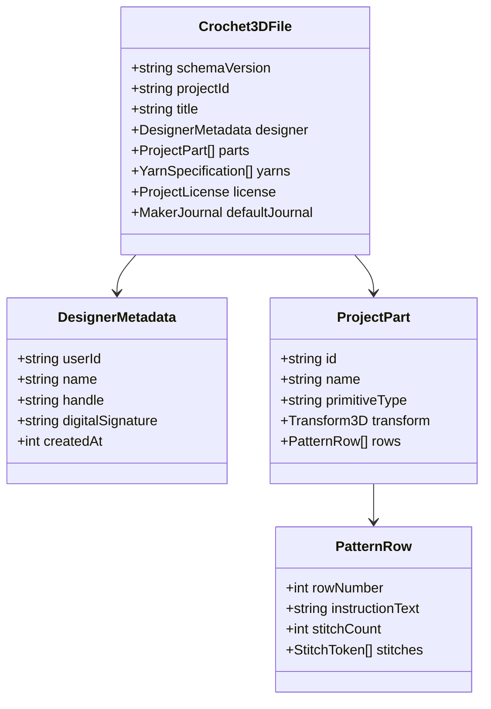

# Pesquisa Técnica: Arquitetura de Dados, Preservação de Direitos e Federação 🗄️🔒

> **Documento de Pesquisa e Engenharia**: Especificação do formato canônico aberto `.crochet3d`, modelo de dados para separação de autoria e diário de execução, políticas de segurança Row Level Security (RLS) e estratégia de sincronização Offline-First.

---

## 1. O Formato Canônico Aberto `.crochet3d`

Atualmente, o mercado de artesanato têxtil carece de um formato de arquivo universal estruturado. Designers utilizam PDFs estáticos ou diagramas rasterizados (PNG/JPEG), impossibilitando a manipulação tridimensional, a leitura automatizada por voz ou a reparametrização de materiais.

O formato **`.crochet3d`** resolve essa lacuna operando como um documento JSON comprimido ou binário estruturado que unifica:
1. **Representação Geométrica Paramétrica**: Definição volumétrica de primitivas, nós de transformação e malhas poligonais;
2. **Árvore Sintática Abstrata (AST) da Receita**: Carreiras, pontos, contagens, cores e instruções semânticas;
3. **Especificação Física de Fios**: Diâmetros em mm, tex, rugosidade, pilosidade e paletas de cores;
4. **Metadados de Autoria Imutáveis e Licença**: Direitos de comercialização e créditos do designer.



---

## 2. Modelo de Vínculo Duplo: Designer vs Maker

Um dos conceitos centrais da arquitetura é a dissociação entre quem **desenhou** a receita e quem está **tecendo** a peça:

```mermaid
flowchart LR
    subgraph DesignerScope ["Escopo de Autoria (Designer) - IMUTÁVEL"]
        DesignOrig["Modelo 3D Original"]
        PatternOrig["Receita Canônica"]
        LicenseRules["Regras de Licença (Venda de Peças Físicas)"]
        AuthorCredits["Nome, @Handle e Redes Sociais"]
    end

    subgraph MakerScope ["Escopo de Execução (Maker / Crafter) - MUTÁVEL"]
        Journal["Diário de Execução Pessoal"]
        Progress["Carreira e Ponto Atual (Progresso)"]
        CustomGauge["Amostra e Tensão Própria (cm)"]
        RealPhotos["Fotos Reais da Peça Pronta"]
        PersonalNotes["Anotações (ex: usei agulha 2.0mm)"]
    end

    DesignerScope -- "Exportado / Compartilhado" --> MakerScope
```



### Regras de Imutabilidade na Federação
- Ao importar um arquivo `.crochet3d` gerado por outro artesão, o aplicativo fixa o objeto `designer` como somente leitura.
- O usuário importador é alocado no papel de `maker`, recebendo um novo `journal` vazio para registrar seu próprio progresso e fotos sem sobrescrever o trabalho do criador original.

---

## 3. Segurança e Controle de Acesso: Supabase Row Level Security (RLS)

A camada de serviços (`ShareService` e `CommunityService`) foi modelada para transição transparente para um backend em nuvem PostgreSQL gerenciado com Supabase. As regras de RLS garantem privacidade matemática no banco de dados:

```sql
-- Regra 1: Projetos Públicos são visíveis por qualquer usuário autenticado ou anônimo
CREATE POLICY "Projetos públicos são abertos para leitura"
ON public.projects
FOR SELECT
USING (visibility = 'public');

-- Regra 2: Projetos Privados só podem ser lidos pelo dono OU por usuários com convite válido
CREATE POLICY "Projetos privados restritos ao dono ou convidados"
ON public.projects
FOR SELECT
USING (
  auth.uid() = owner_id
  OR EXISTS (
    SELECT 1 FROM public.project_shares
    WHERE project_shares.project_id = projects.id
      AND (
        project_shares.grantee_user_id = auth.uid()
        OR project_shares.access_token = current_setting('request.headers.x-access-token', true)
      )
  )
);

-- Regra 3: Apenas donos e co-autores (permissão 'editor') podem atualizar receitas
CREATE POLICY "Apenas dono ou co-autores autorizados podem editar"
ON public.projects
FOR UPDATE
USING (
  auth.uid() = owner_id
  OR EXISTS (
    SELECT 1 FROM public.project_shares
    WHERE project_shares.project_id = projects.id
      AND project_shares.grantee_user_id = auth.uid()
      AND project_shares.permission = 'editor'
  )
);
```

---

## 4. Estratégia de Sincronização Offline-First

O aplicativo foi projetado para operar sem internet (como em viagens, parques ou salas de aula):

1. **Armazenamento Primário Local**:
   - Todo o estado (projetos, perfis, progresso e fotos em base64) reside no **IndexedDB** do navegador via Dexie.js.
   - Zero dependência de rede para renderização 3D, cálculos matemáticos, sintetização de voz TTS e exportação de PDF.
2. **Fila de Sincronização em Nuvem (Outbox Pattern)**:
   - Quando uma conexão com a internet estiver disponível e o usuário optar por vincular sua conta em nuvem, alterações locais são enfileiradas em uma tabela `sync_queue` e despachadas com timestamps de controle de concorrência baseados em *Last-Write-Wins* (LWW) e identificadores de versão determinísticos (UUIDv4).

---

## 5. Tópicos para Pesquisas Futuras

1. **Assinatura Criptográfica de Receitas (NFT / Ed25519)**: Prover certificados digitais de autenticidade para receitas exclusivas de alta-costura em crochê, garantindo a rastreabilidade da criação.
2. **Algoritmos CRDT para Co-Autoria em Tempo Real**: Implementar tipos de dados replicados sem conflito (Yjs / Automerge) para que dois designers possam editar a mesma receita de crochê e o modelo 3D colaborativamente e simultaneamente em telas diferentes.
3. **Conversão de Formatos Legados com IA**: Treinar modelos de visão computacional e OCR especializados em decifrar diagramas gráficos circulares tradicionais de revistas japonesas e russas para o formato digital `.crochet3d`.
