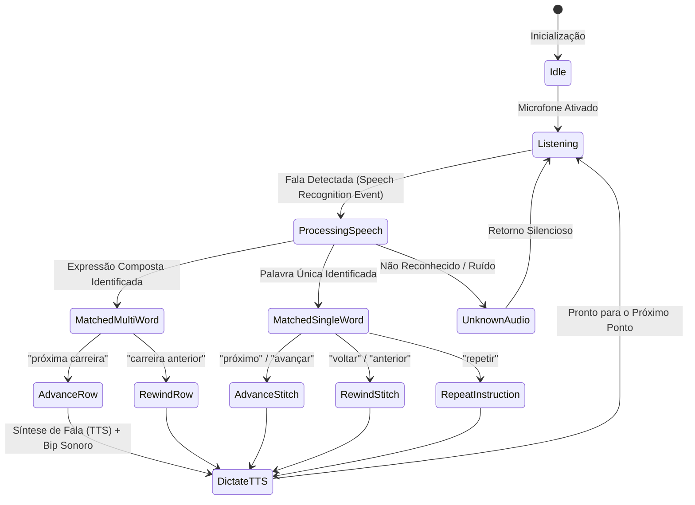

# Pesquisa Técnica: Ergonomia, Acessibilidade e Engenharia de Voz Hands-Free 🎙️🧶

> **Documento de Pesquisa e Engenharia**: Análise biomecânica do trabalho manual têxtil, arquitetura de interação por voz em ambientes domésticos, ergonomia para destros e canhotos e prevenção de lesões por esforço repetitivo (LER/DORT).

---

## 1. Biomecânica da Crochetagem e a Restrição "Mãos Ocupadas"

Em atividades de artesanato manual como crochê e amigurumi, as mãos do praticante desempenham funções motoras finas contínuas e altamente assimétricas:

- **Mão Dominante (Mão da Agulha)**: Realiza movimentos cíclicos de pronação, supinação e flexão do punho para inserir a ponta da agulha no ponto, laçar o fio e puxá-lo através das laçadas.
- **Mão Não-Dominante (Mão do Fio e Guia)**: Mantém a tensão constante do fio passando entre os dedos (essencial para a uniformidade do *gauge*) e segura a peça física para fornecer resistência mecânica contra a tração da agulha.

### O Problema da Interrupção de Fluxo (Context Switching)
Em métodos tradicionais, para consultar a receita em um smartphone ou folha de papel, o artesão precisa:
1. Soltar a agulha ou a tensão do fio com uma das mãos;
2. Rolar a tela ou marcar a carreira com caneta/contador manual;
3. Retomar a postura de tensão dos dedos e reencontrar o ponto correto.

Esse ciclo de interrupção consome entre **15% a 25% do tempo total de execução** e aumenta significativamente o risco de erros de contagem de pontos. Daí decorre a necessidade imperativa de uma interface **100% Hands-Free**.

---

## 2. Engenharia de Interação por Voz: Máquina de Estados Finitos (FSM)

Para evitar que palavras comuns da conversa doméstica ou ruídos do clique da agulha disparem comandos involuntários, a navegação por voz opera como uma **Máquina de Estados Finitos com Desambiguação de Prefixos**:

### Resolução do Problema de Shadowing de Comandos
Um dos desafios críticos identificados e solucionados na implementação é o *prefix shadowing*: se o usuário disser `"carreira anterior"`, um analisador ingênuo poderia casar a palavra `"anterior"` isoladamente e disparar uma volta de ponto em vez de uma volta de carreira inteira.

A solução formal implementada exige ordenação estrita das regras de correspondência por **comprimento e especificidade decrescente**:

$$\text{Regras} = \left[ \text{"próxima carreira"}, \text{"carreira anterior"}, \text{"próximo"}, \text{"anterior"}, \text{"repetir"} \right]$$

---

## 3. Ergonomia para Artesãos Canhotos (*Left-Handed Ergonomics*)

Aproximadamente 10% a 12% dos crocheteiros mundiais são canhotos. No crochê, isso impõe inversões topológicas fundamentais:

| Aspecto | Artesão Destro | Artesão Canhoto | Adaptação no Sistema |
| :--- | :--- | :--- | :--- |
| **Sentido da Carreira Circular** | Anti-horário (Counter-clockwise) | Horário (Clockwise) | Inversão da coordenada $\theta_j$ na reconstrução 3D |
| **Orientação da Agulha** | Segura com a mão direita, penetra da direita para esquerda | Segura com a mão esquerda, penetra da esquerda para direita | Espelhamento horizontal dos diagramas SVG e tutoriais |
| **Inclinação de Diminuições Invisíveis** | Laça a alça da frente inclinando à esquerda | Laça a alça da frente inclinando à direita | Inversão do ângulo de rotação da agulha nos tutoriais |

---

## 4. Prevenção de LER/DORT e Saúde Ocupacional

O crochê repetitivo pode desencadear tenossinovite de De Quervain, síndrome do túnel do carpo e tendinite nos extensores do punho.

### Diretrizes de Saúde Integradas ao Modo Crochetagem:
1. **Temporizador de Pausa Ergonométrica**: O sistema monitora o tempo contínuo de crochetagem e, a cada 45 minutos ininterruptos, sugere verbalmente uma pausa de 3 minutos para alongamento dos dedos e punhos.
2. **Controle de Ritmo Cadenciado (Pacing)**: O artesão pode configurar uma velocidade confortável de ditado (palavras por minuto) para evitar aceleração excessiva involuntária em dias de tensão.
3. **Feedback Auditivo Redundante**: O bip suave da Web Audio API confirma que o comando foi aceito antes mesmo que a voz TTS comece a falar, reduzindo a ansiedade do usuário.

---

## 5. Tópicos para Pesquisas Futuras

1. **Reconhecimento de Voz Local com WebAssembly (Whisper WASM)**: Eliminar a dependência de conectividade com servidores externos de reconhecimento de fala usando modelos compactos rodando 100% offline via WebGPU/WASM.
2. **Reconhecimento de Gestos sem Toque (Computer Vision / MediaPipe)**: Permitir acenar na frente da câmera frontal do celular ou tablet para avançar o ponto sem emitir sons (ideal para artesãos que assistem TV ou ouvem podcasts enquanto tecem).
3. **Sensores em Agulhas Inteligentes (BLE Hooks)**: Pesquisar agulhas de crochê com giroscópio e acelerômetro Bluetooth de baixa energia que contam os pontos fisicamente a cada laçada concluída.
