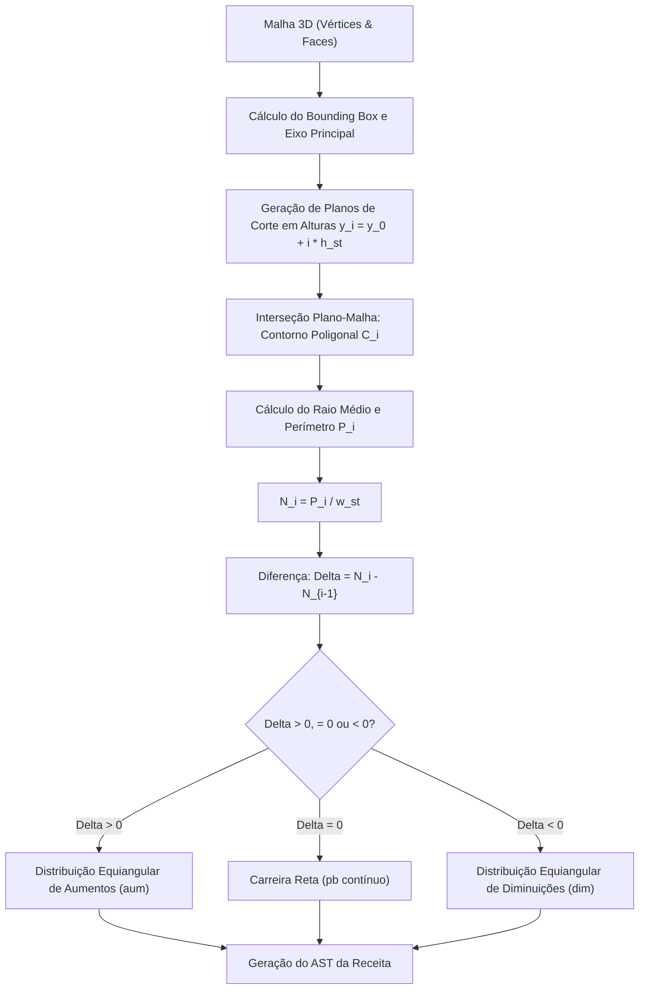

# Pesquisa Técnica: Modelagem Matemática e Fatiamento de Superfícies Têxteis 🧶📐

> **Documento de Pesquisa e Engenharia**: Análise matemática, geométrica e algorítmica para a conversão bidirecional entre geometria tridimensional discreta e receitas paramétricas de crochê.

---

## 1. Fundamentos Matemáticos do Crochê e Topologia

Diferente da tecelagem plana ou do tricô (que operam essencialmente sobre malhas retangulares ou estruturas ortogonais $\mathbb{R}^2$), o **crochê** possui uma propriedade topológica e geométrica única: cada ponto é ancorado individualmente em um ponto da carreira anterior através de laçadas independentes.

Isso confere ao crochê a capacidade de construir superfícies com curvatura Gaussiana ($K$) arbitrária:

$$K = \kappa_1 \cdot \kappa_2$$

1. **Curvatura Nula ($K = 0$ - Geometria Euclidiana)**:
   - Cilindros perfeitos, cones e superfícies planas.
   - Taxa de variação de pontos nula por carreira ($\Delta N = 0$).
2. **Curvatura Positiva ($K > 0$ - Geometria Elíptica/Esférica)**:
   - Amigurumis, esferas, domos e formas convexas fechadas.
   - Taxa de variação decrescente em relação ao perímetro ($\Delta N < 0$ após o equador).
3. **Curvatura Negativa ($K < 0$ - Geometria Hiperbólica)**:
   - Babados, corais marinhos, bordas onduladas e superfícies pseudocilíndricas (popularizado pelos trabalhos matemáticos de *Daina Taimina* em Cornell).
   - Taxa de aumento exponencial constante ($\Delta N = c \cdot N_{i-1}$, onde $c > 0$).

---

## 2. Relação de Gauge, Passo e Discretização Espacial

Para mapear uma malha 3D contínua $\mathcal{M} = (\mathcal{V}, \mathcal{E}, \mathcal{F})$ em uma sequência discreta de pontos de crochê, precisamos modelar o ponto como um elemento volumétrico finito (voxel têxtil):

- **Altura do Ponto ($h_{st}$)**: Determinada pelo tipo de ponto (ex: $h_{pb} \approx 1.0 \times \phi_{fio}$, $h_{pa} \approx 2.5 \times \phi_{fio}$, onde $\phi_{fio}$ é o diâmetro efetivo do fio).
- **Largura do Ponto ($w_{st}$)**: Determinada pela espessura do fio e pela tensão da agulha ($w_{st} \approx 1.2 \times \phi_{fio}$).
- **Espessura da Casca ($\delta$)**: A casca de crochê é uma variedade bidirecional imersa em $\mathbb{R}^3$ com espessura finita $\delta \approx 2 \times \phi_{fio}$.

### Equação de Densidade Linear de Pontos
Para uma volta circular de raio $r$, o número ideal de pontos $N$ em uma carreira é dado pelo perímetro euclidiano dividido pela largura do ponto:

$$N(r) = \text{round}\left( \frac{2 \pi r}{w_{st}} \right)$$

---

## 3. Algoritmo de Fatiamento Radial (`MeshSlicer`)

O motor de fatiamento do projeto implementa um fatiamento planar adaptativo ao longo do eixo principal de simetria da peça (tipicamente o eixo $Y$ vertical):

### Algoritmo de Partição Equiangular de Aumentos e Diminuições
Para evitar assimetrias na peça física (que causariam deformações indesejadas como "amigurumis tortos"), os aumentos e diminuições devem ser distribuídos uniformemente ao longo dos $360^\circ$ da carreira:

Seja $N_{prev}$ o número de pontos da carreira anterior e $N_{target}$ o alvo da carreira atual:
- Se $\Delta N = N_{target} - N_{prev} > 0$:
  Precisamos de $k = \Delta N$ aumentos. O intervalo de pontos regulares entre cada aumento é:
  $$I = \left\lfloor \frac{N_{prev} - k}{k} \right\rfloor$$
  Resultando na fórmula canônica: `[I pb, 1 aum] x k`, com qualquer resíduo restante $R = (N_{prev} - k) \pmod k$ distribuído simetricamente nas pontas.

- Se $\Delta N < 0$:
  Precisamos de $k = |\Delta N|$ diminuições (cada diminuição consome 2 pontos da base e produz 1 ponto final).
  O total de pontos de base consumidos é $2k$, restando $N_{prev} - 2k$ pontos de base para pontos regulares:
  $$I = \left\lfloor \frac{N_{prev} - 2k}{k} \right\rfloor$$
  Resultando na fórmula canônica: `[I pb, 1 dim] x k`.

---

## 4. Reconstrução Inversa: Receita $\rightarrow$ Geometria 3D (`RecipeToMesh`)

Para renderizar o modelo em tempo real a partir de uma receita digitada pelo usuário, o algoritmo constrói uma **superfície paramétrica helicoidal discretizada**:

Para cada carreira $i$ com $N_i$ pontos e altura acumulada $y_i$:
1. O raio da carreira é inferido da contagem de pontos:
   $$r_i = \frac{N_i \cdot w_{st}}{2\pi}$$
2. Cada ponto $j \in \{0, \dots, N_i - 1\}$ gera um vértice central no espaço:
   $$\theta_j = \frac{2\pi j}{N_i}$$
   $$x_j = r_i \cos(\theta_j), \quad y_j = y_i, \quad z_j = r_i \sin(\theta_j)$$
3. Uma malha tubular contínua é gerada unindo as carreiras adjacentes através de uma triangulação quad-to-triangle em fita (`IndexBuffer` otimizado).

---

## 5. Tópicos para Pesquisas Futuras

1. **Fatiamento Não-Planar Geodésico**: Fatiar malhas anatômicas complexas seguindo as linhas geodésicas de tensão mecânica em vez de planos horizontais fixos.
2. **Deformação Dinâmica por Enchimento (Soft-Body Physics)**: Simular o efeito da fibra siliconada estufando a casca de crochê através de simulação de tecidos em GPU (Position Based Dynamics - PBD).
3. **Resolução de Junção Multi-Peça (Costura Automática)**: Gerar algoritmos que determinam o caminho ótimo de costura com agulha de tapeçaria entre partes adjacentes (ex: braço cilíndrico ancorado em tronco esférico).
