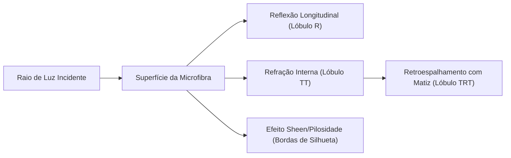

# Pesquisa Técnica: Shaders PBR e Física de Fios em Tempo Real 🧶✨

> **Documento de Pesquisa e Engenharia**: Análise de modelos de iluminação de fibras têxteis, shaders procedurais de laçadas e otimizações WebGL para dispositivos móveis e desktop.

---

## 1. Óptica de Fibras Têxteis e Modelos de Iluminação

A renderização realista de fios de crochê no navegador difere substancialmente da renderização de superfícies duras (como plástico ou metal polido). Fios são estruturas anisotrópicas compostas por milhares de microfibras torcidas (*plies*), gerando espalhamento volumétrico subsuperficial (*subsurface scattering*), retroespalhamento difuso e reflexão especular cilíndrica.

### Modelos de Iluminação Analisados:
1. **Modelo de Marschner (2003)**:
   - Padrão ouro em computação gráfica para cabelo e pelos de animais. Modela os 3 lóbulos de dispersão cilíndrica ($R$, $TT$ e $TRT$).
   - *Limitação na Web*: Extremamente custoso para WebGL padrão em dispositivos móveis devido a múltiplas funções transcendentais por fragmento.
2. **Modelo de Kajiya-Kay (1989)**:
   - Modela a reflexão especular baseada no produto escalar do vetor tangente da fibra $\mathbf{T}$ e a direção da luz $\mathbf{L}$:
     $$I_{spec} = k_s \left( \sqrt{1 - (\mathbf{T} \cdot \mathbf{L})^2} \sqrt{1 - (\mathbf{T} \cdot \mathbf{V})^2} - (\mathbf{T} \cdot \mathbf{L})(\mathbf{T} \cdot \mathbf{V}) \right)^p$$
3. **Abordagem Híbrida Adotada no Projeto (PBR Standard + Sheen/Velvet Fuzziness + Normal Map Procedural)**:
   - Extensão do modelo microfacet de Cook-Torrance do Three.js, injetando um termo de pilosidade de Fresnel nos fragmentos de contorno (*rim lighting*), combinado com perturbações procedurais da normal de superfície.

---

## 2. Síntese Procedural da Textura de Laçadas

Para atingir 60 FPS estáveis mesmo em modelos com milhares de pontos sem criar milhões de triângulos na CPU, o sistema sintetiza a geometria dos pontos de crochê diretamente no fragment shader através de funções analíticas periódicas.

Seja $(u, v)$ as coordenadas de textura locais normalizadas por carreira e ponto:
- $u \in [0, 1]$ mapeia o arco angular de um ponto individual.
- $v \in [0, 1]$ mapeia a altura da carreira.

A perturbação de relevo $\Delta h(u, v)$ que emula a laçada em "V" característica do ponto baixo (`pb`) é expressa por:

$$\Delta h(u, v) = \alpha \cdot \cos(2\pi u) \cdot \sin(\pi v) + \beta \cdot |\sin(4\pi u)| \cdot (1 - v)$$

O vetor normal perturbado $\mathbf{N}'$ é computado via derivadas parciais analíticas:

$$\mathbf{N}' = \text{normalize}\left( \mathbf{N} - \frac{\partial \Delta h}{\partial u} \mathbf{T} - \frac{\partial \Delta h}{\partial v} \mathbf{B} \right)$$

Onde $\mathbf{T}$ e $\mathbf{B}$ são os vetores tangente e bitangente da superfície no espaço da câmera.

---

## 3. Comportamento Óptico dos Tipos de Fio

| Tipo de Fio | Propriedades Ópticas | Implementação no Shader |
| :--- | :--- | :--- |
| **Algodão Tradicional** | Mercerizado, brilho sutil, alta definição de ponto | Rugosidade média ($0.45$), relevo de normal acentuado, baixo efeito *sheen*. |
| **Fio Amigurumi** | 100% algodão torcido, textura fosca e firme | Rugosidade moderada ($0.65$), *bump* com frequência média, leve penugem periférica. |
| **Chenille / Pelúcia** | Fio felpudo volumoso, pontos quase indistinguíveis | Alto *roughness* ($0.95$), *sheen* intenso nas bordas (efeito veludo), relevo difuso e suave. |
| **Fio de Malha** | Fita contínua elástica, superfície lisa e tubular | Rugosidade baixa/média ($0.35$), linhas de emenda longitudinais bem definidas. |

---

## 4. Otimizações de Performance WebGL e Mobile

### Orçamento de Draw Calls e Polígonos
Em navegadores móveis (Safari iOS e Chrome Android), o limite seguro para manter $\ge 30 \text{ FPS}$ sob gestão de energia térmica é:
- **Vértices simultâneos**: $\le 150.000$ vértices na cena.
- **Draw Calls**: $\le 20$ chamadas de desenho por quadro.
- **Uso de Memória de Textura**: Shaders 100% analíticos/procedurais eliminam o carregamento de arquivos de textura pesados (economia de 50MB a 100MB de VRAM).

### Pipeline de Simplificação com QEM (Quadric Error Metric)
Para malhas importadas de softwares de escultura (Blender / ZBrush) que frequentemente possuem mais de 100.000 triângulos:
1. O algoritmo calcula as matrizes quádricas fundamentais $Q_v$ em cada vértice:
   $$Q_v = \sum_{f \in \text{faces}(v)} \mathbf{p}_f \mathbf{p}_f^T$$
2. As arestas de menor custo de colapso são contraídas sequencialmente até que a malha atinja a densidade alvo equivalente à resolução dos pontos de crochê.

---

## 5. Próximos Passos de Pesquisa Gráfica

1. **Shell-Texturing em GPU para Pelos de Chenille**: Gerar camadas concêntricas semitransparentes deslocadas ao longo da normal (*shell texturing*) para criar cerdas tridimensionais reais em modelos de pelúcia.
2. **WebGPU Compute Shaders**: Migrar a computação de fatiamento e malhas tubulares para WebGPU Compute Shaders, liberando a CPU principal durante importações complexas.
3. **Ray-Marching de Curvas Hermite**: Renderização de close-ups extremos onde cada laçada de ponto é traçada analiticamente por ray-marching volumétrico em caixas delimitadoras locais.
