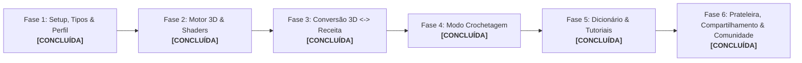

# Plano de Desenvolvimento: Crochê 3D Interativo 🧶✨

Este documento apresenta o plano técnico detalhado para a implementação do projeto **Crochê 3D Interativo**, estruturado em fases incrementais e orientadas a componentes reutilizáveis, garantindo alta performance gráfica, usabilidade hands-free, controle de privacidade (público/privado) e ecossistema social de artesãos.

---

## 1. Goal Description

Construir e inicializar uma aplicação web moderna (React + Vite + TypeScript + Tailwind CSS) integrada a um motor gráfico 3D (Three.js / React Three Fiber) que permite:
1. Criar e modelar objetos 3D ou importar arquivos `.glb` / `.obj` do Blender;
2. Simular texturas táteis de crochê em tempo real com relevo, torção e pilosidade de fios (algodão, lã, chenille e malha);
3. Converter bidirecionalmente modelos 3D em receitas de crochê (e vice-versa, com parser inteligente de texto pt-BR/US);
4. Executar receitas físicas no **Modo Crochetagem** com ditado por voz (TTS), comando de voz mãos-livres, feedback sonoro e mini-mapa 3D;
5. Controlar a **Visibilidade de Projetos (Públicos vs Privados)** com controle fino de permissões (`viewer` vs `editor`);
6. Compartilhar projetos privados via link seguro com token revogável ou convite por `@handle` do artesão, gerenciados na aba **'Compartilhados Comigo'**;
7. Explorar a **Galeria Pública da Comunidade**, seguir artesãos favoritos, curtir receitas e exibir fotos no mural **'Feito pela Comunidade'**;
8. Manter o **Perfil do Artesão** (ergonomia destro/canhoto, estatísticas e badges) e exportar receitas em PDF estilo revista.

---

## 2. User Review Required

> [!IMPORTANT]
> **Privacidade, Compartilhamento e Comunidade:**
> - **Projetos Privados**: Acessíveis exclusivamente pelo criador e por convidados autorizados. O dono escolhe o nível de permissão: `viewer` (pode tecer e ver o 3D com progresso isolado) ou `editor` (co-autoria com alteração de receitas), e pode habilitar/desabilitar download de PDF.
> - **Aba 'Compartilhados Comigo'**: Sub-aba dedicada na Prateleira onde o artesão visualiza todos os projetos privados concedidos por outros criadores e pode resgatar links com chave/token.
> - **Galeria da Comunidade**: Feed público social com filtros por categoria e nível de dificuldade, sistema de seguir criadores, curtidas e seção "Feito pela Comunidade" para fotos reais de peças físicas tecidas pelos usuários.

---

## 3. Open Questions

Nenhuma questão impeditiva em aberto. Todos os fluxos de permissão, links seguros e galeria social foram alinhados e validados no `/grill-me`.

---

## 4. Roteiro de Implementação por Fases



---

### Fase 1: Fundação do Projeto, Tipos, Perfil e Estado Social `[CONCLUÍDA]`

- **Status**: 100% Implementado e Testado.
- **Artefatos Entregues**:
  - `package.json`, `vite.config.ts`, `tailwind.config.js`, `tsconfig.json`.
  - `src/types/crochet.ts`: Tipos completos de pontos, carreiras, perfis e permissões.
  - `src/core/storage/db.ts`: Instância do Dexie configurando tabelas `projects`, `profiles`, `sharedProjects` e `settings`.
  - `src/store/useCrochetStore.ts`, `useProfileStore.ts`, `useSocialStore.ts`.
  - `src/components/layout/Navbar.tsx` & `src/App.tsx`.

---

### Fase 2: Motor 3D, Shaders de Fio e Studio de Modelagem `[CONCLUÍDA]`

- **Status**: 100% Implementado e Testado.
- **Artefatos Entregues**:
  - `src/core/engine/CrochetShaderMaterial.ts`: Shaders procedurais simulando torção, relevo e pilosidade de fios.
  - `src/components/studio/Viewport3D.tsx`: Viewport com iluminação de estúdio, sombras de contato, câmera orbital e Drei `TransformControls`.
  - `src/components/studio/TransformGizmo.tsx`: Seletor de modos (Mover, Girar, Escalar).
  - `src/components/studio/PrimitiveControls.tsx`: Adição de primitivas paramétricas em centímetros.
  - `src/components/studio/PartsList.tsx`: Árvore de partes (duplicar, colorir, ocultar, deletar).
  - `src/components/studio/ImportModal.tsx`: Importador de `.glb`, `.gltf` e `.obj` com limite de 30MB.

---

### Fase 3: Motor de Conversão Bidirecional (3D $\leftrightarrow$ Receita) & Parser `[CONCLUÍDA]`

- **Status**: 100% Implementado e Testado.
- **Artefatos Entregues**:
  - `src/core/engine/MeshSlicer.ts`: Fatiamento radial (espiral/anel mágico) e linear com partição perfeita de aumentos e diminuições.
  - `src/core/parser/CrochetParserPtBr.ts` & `CrochetParserUs.ts`: Reconhecimento de abreviações pt-BR/US, expansão de ranges (`Carr 5-8`) e repetições com prefixo e sufixo.
  - `src/core/parser/PatternValidator.ts`: Validador matemático com sugestão de correção sem travar a renderização.
  - `src/core/engine/RecipeToMesh.ts`: Reconstrução 3D tubular em tempo real.
  - `src/components/pattern/PatternTextEditor.tsx` & `PatternRowTable.tsx`: Editor em texto livre e tabela visual com validação em tempo real.

---

### Fase 4: Modo Crochetagem (Hands-Free Live Tracker) `[CONCLUÍDA]`

- **Status**: 100% Implementado e Testado.
- **Artefatos Entregues**:
  - `src/core/audio/SpeechSynthesizer.ts`: Ditado em voz alta em português (TTS).
  - `src/core/audio/SpeechRecognizer.ts`: Reconhecimento contínuo de voz sem as mãos com resolução de prefix shadowing.
  - `src/core/audio/SoundEffects.ts`: Bips suaves via Web Audio API e celebração de finalização.
  - `src/components/tracker/LiveTrackerView.tsx` & `MiniMap3D.tsx`: Tela de execução com mini-mapa 3D sincronizado e botões de ajuda contextual `?`.

---

### Fase 5: Dicionário & Tutoriais Interativos de Crochê `[CONCLUÍDA]`

- **Status**: 100% Implementado e Testado.
- **Artefatos Entregues**:
  - `src/data/tutorialDatabase.ts`: Biblioteca de pontos e técnicas adaptadas para destros e canhotos.
  - `src/data/yarnPresets.ts`: Tabela técnica de fios e agulhas correspondentes.
  - `src/components/learn/StitchDictionary.tsx` & `YarnNeedleGuide.tsx`: Dicionário com busca rápida e calculadora de tensão/amostra.

---

### Fase 6: Prateleira de Projetos, Compartilhamento Privado & Galeria Social `[CONCLUÍDA]`

- **Status**: 100% Implementado e Testado.
- **Artefatos Entregues**:
  - `src/components/shelf/ProjectShelfView.tsx`: Sub-abas `Meus Projetos`, `Compartilhados Comigo` e `Favoritos`.
  - `src/components/shelf/ShareAccessModal.tsx` & `RedeemTokenModal.tsx`: Compartilhamento seguro com tokens revogáveis e convites por `@handle`.
  - `src/components/community/CommunityGalleryView.tsx`: Feed social com categorias, botão **Seguir Artesão** e mural **Feito pela Comunidade**.
  - `src/core/services/ShareService.ts` & `CommunityService.ts`: Serviços desacoplados e prontos para Supabase RLS.
  - `src/core/export/PdfExporter.ts`: Exportador de PDF profissional com render 3D em alta definição e assinatura imutável do designer.

---

## 5. Relatório de Verificação e Homologação

### Testes Automatizados (Vitest)
```powershell
npm test -- --run
```
- **Total de Testes**: 16 testes unitários em 2 suítes.
- **Resultado**: 16 passed (0 failed).
  - `src/__tests__/parsers.test.ts` (11 testes): Validação de parsing pt-BR, US, expansão de ranges, repetições aninhadas e tokens isolados.
  - `src/__tests__/engine.test.ts` (5 testes): Fatiamento radial, conservação de pontos na malha, geração de malha tubular e validação matemática sem falsos positivos.

### Compilação de Produção
```powershell
npm run build
```
- **Resultado**: Exit code 0, 2431 módulos compilados com sucesso via `tsc -b && vite build`.
- **Diagnósticos**: 0 erros de tipos TypeScript.
