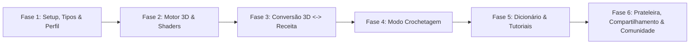

# Plano de Desenvolvimento: Crochê 3D Interativo 🧶✨

Este documento apresenta o plano técnico detalhado para a implementação do projeto **Crochê 3D Interativo**, estruturado em fases incrementais e orientadas a componentes reutilizáveis, garantindo alta performance gráfica, usabilidade hands-free, controle de privacidade (público/privado) e ecossistema social de artesãos.

---

## 1. Goal Description

Construir e inicializar uma aplicação web moderna (React + Vite + TypeScript + Tailwind CSS) integrada a um motor gráfico 3D (Three.js / React Three Fiber) que permite:
1. Criar e modelar objetos 3D ou importar arquivos `.glb` / `.obj` do Blender;
2. Simular texturas táteis de crochê em tempo real com relevo, torção e pilosidade de fios (algodão, lã, chenille e malha);
3. Converter bidirecionalmente modelos 3D em receitas de crochê (e vice-versa, com parser inteligente de texto pt-BR/US);
4. Executar receitas físicas no **Modo Crochetagem** com ditado por voz (TTS), comando de voz mãos-livres, feedback sonoro e mini-mapa 3D;
5. Controlar a **Visibilidade de Projetos (Públicos vs Privados)** com controle fino de permissões (`viewer` vs `editor`);
6. Compartilhar projetos privados via link seguro com token revogável ou convite por `@handle` do artesão, gerenciados na aba **'Compartilhados Comigo'**;
7. Explorar a **Galeria Pública da Comunidade**, seguir artesãos favoritos, curtir receitas e exibir fotos no mural **'Feito pela Comunidade'**;
8. Manter o **Perfil do Artesão** (ergonomia destro/canhoto, estatísticas e badges) e exportar receitas em PDF estilo revista.

---

## 2. User Review Required

> [!IMPORTANT]
> **Privacidade, Compartilhamento e Comunidade:**
> - **Projetos Privados**: Acessíveis exclusivamente pelo criador e por convidados autorizados. O dono escolhe o nível de permissão: `viewer` (pode tecer e ver o 3D com progresso isolado) ou `editor` (co-autoria com alteração de receitas), e pode habilitar/desabilitar download de PDF.
> - **Aba 'Compartilhados Comigo'**: Sub-aba dedicada na Prateleira onde o artesão visualiza todos os projetos privados concedidos por outros criadores e pode resgatar links com chave/token.
> - **Galeria da Comunidade**: Feed público social com filtros por categoria e nível de dificuldade, sistema de seguir criadores, curtidas e seção "Feito pela Comunidade" para fotos reais de peças físicas tecidas pelos usuários.

---

## 3. Open Questions

Nenhuma questão impeditiva em aberto. Todos os fluxos de permissão, links seguros e galeria social foram alinhados e validados no `/grill-me`.

---

## 4. Proposed Changes: Roteiro de Implementação por Fases



---

### Fase 1: Fundação do Projeto, Tipos, Perfil e Estado Social

Configurar a infraestrutura inicial do projeto, tipagens rigorosas, sistema de persistência com IndexedDB e layout base com navegação entre as abas e painel de perfil.

#### [NEW] `package.json`
- Definir scripts (`dev`, `build`, `preview`) e dependências do projeto:
  - `react`, `react-dom`
  - `three`, `@types/three`, `@react-three/fiber`, `@react-three/drei`
  - `lucide-react`, `clsx`, `tailwind-merge`
  - `zustand` (gerenciamento de estado)
  - `dexie` (IndexedDB simplificado e reativo)
  - `jspdf` (geração de PDF vetorial)
  - `canvas-confetti` (celebração ao concluir peças)

#### [NEW] `vite.config.ts`, `tsconfig.json`, `tailwind.config.js`, `postcss.config.js`
- Configurar Vite com plugin React e alias de path (`@/*`).
- Configurar Tailwind com esquema de cores aconchegante para artesanato (tons de terracota, sálvia, lavanda, creme e dark mode elegante).

#### [NEW] `src/types/crochet.ts`
- Tipos de pontos (`corr`, `pb`, `pa`, `mpa`, `pbx`, `pad`, `aum`, `dim`, `dim_inv`, `am`).
- Interfaces completas: `ArtisanProfile`, `ProjectLicense`, `ProjectShareEntry`, `CommunityMake`, `MakerJournal`, `PatternRow`, `ProjectPart`, `YarnSpecification`, `CrochetProject`, `StitchTutorial`.

#### [NEW] `src/core/storage/db.ts`
- Instância do Dexie configurando as tabelas `projects`, `profiles`, `sharedProjects` e `settings`.
- Inicialização com perfil de artesão padrão ("Artesão Criativo") e modelos prontos.

#### [NEW] `src/store/useCrochetStore.ts`, `useProfileStore.ts` & `useSocialStore.ts`
- Estados reativos com Zustand: projeto ativo, perfil do usuário, lista de artesãos seguidos, curtidas e projetos compartilhados.

#### [NEW] `src/components/layout/Navbar.tsx` & `src/App.tsx`
- Cabeçalho responsivo com seletor de abas (Studio, Editor, Tracker, Tutoriais, Prateleira e Comunidade), card de perfil com avatar e alternador de tema.

---

### Fase 2: Motor 3D, Shaders de Fio e Studio de Modelagem

Construir o viewport 3D interativo com renderização PBR tátil do crochê e ferramentas de modelagem multi-peças.

#### [NEW] `src/core/engine/CrochetShaderMaterial.ts`
- Shader Three.js personalizado (`ShaderMaterial` ou extensão de `MeshStandardMaterial` via `onBeforeCompile`):
  - Simula a textura ondulada e entrelaçada dos pontos de crochê (bump e normal procedural).
  - Simulação de pilosidade do fio (rim light / fuzziness tipo velvet/sheen).
  - Parâmetros: cor primária, cor de destaque (carreira/ponto ativo), diâmetro do fio e rugosidade.

#### [NEW] `src/components/studio/Viewport3D.tsx`
- Canvas React Three Fiber com iluminação em três pontos (Key, Fill, Rim light), sombra de contato (`ContactShadows`), e controles orbitais com amortecimento suave.
- Suporte a seleção de peças com clique do mouse na cena.

#### [NEW] `src/components/studio/TransformGizmo.tsx`
- Controles de Transformação Drei (`TransformControls`) para manipular posição, rotação e escala da peça ativa em X, Y, Z.

#### [NEW] `src/components/studio/PrimitiveControls.tsx`
- Painel para adicionar novas partes com geometrias paramétricas (Esfera, Cilindro, Cápsula, Cone, Cubo, Torus).
- Controle de dimensões reais em centímetros (largura, altura, profundidade).

#### [NEW] `src/components/studio/PartsList.tsx`
- Árvore de partes do modelo (ex: Cabeça, Tronco, Braços, Orelhas), permitindo renomear, ocultar, deletar, duplicar e atribuir cores individuais.

#### [NEW] `src/components/studio/ImportModal.tsx`
- Importador de modelos 3D externos (`.glb`, `.gltf`, `.obj`) com limite de 30MB, centralização e detecção de sub-malhas.

---

### Fase 3: Motor de Conversão Bidirecional (3D $\leftrightarrow$ Receita) & Parser

Implementar o fatiador 3D para receitas e o parser inteligente com editor estruturado.

#### [NEW] `src/core/engine/MeshSlicer.ts`
- Algoritmo que fatia a geometria 3D em modo espiral/circular ou linear.

#### [NEW] `src/core/parser/CrochetParserPtBr.ts` & `CrochetParserUs.ts`
- Parser Regex robusto capaz de interpretar receitas em texto livre pt-BR e US.

#### [NEW] `src/core/parser/PatternValidator.ts`
- Validador matemático: calcula se os aumentos e diminuições da carreira batem com a quantidade de pontos da carreira anterior.

#### [NEW] `src/core/engine/RecipeToMesh.ts`
- Constrói a geometria 3D tubular/discreta correspondente à receita digitada pelo usuário.

#### [NEW] `src/components/pattern/PatternTextEditor.tsx` & `PatternRowTable.tsx`
- Interface com abas para edição: "Modo Texto Livre" e "Modo Tabela Visual".

---

### Fase 4: Modo Crochetagem (Hands-Free Live Tracker)

Criar a experiência imersiva para o artesão crochetar sem usar as mãos, sincronizada com as estatísticas do perfil.

#### [NEW] `src/core/audio/SpeechSynthesizer.ts` & `SpeechRecognizer.ts`
- Wrapper de voz TTS em português e reconhecimento de comandos hands-free ("Próximo", "Voltar", "Repetir").

#### [NEW] `src/core/audio/SoundEffects.ts`
- Efeitos sonoros suaves (bip de avanço e melodia ao concluir peça).

#### [NEW] `src/components/tracker/LiveTrackerView.tsx` & `MiniMap3D.tsx`
- Tela cheia com carreira ativa, tipografia de alto contraste, mini-mapa 3D integrado e botão de ajuda rápida `?`.

---

### Fase 5: Dicionário & Tutoriais Interativos de Crochê

Base de conhecimento integrada com materiais visuais e tabelas de referência com suporte ergonômico.

#### [NEW] `src/data/tutorialDatabase.ts` & `yarnPresets.ts`
- Coleção completa de tutoriais de pontos/técnicas com instrução para destros e canhotos e catálogo de fios industriais.

#### [NEW] `src/components/learn/StitchDictionary.tsx` & `YarnNeedleGuide.tsx`
- Dicionário com busca rápida, categorias e calculadora de tensão/amostra.

---

### Fase 6: Prateleira de Projetos, Compartilhamento Privado & Galeria da Comunidade

Área completa de gestão de projetos, controle de acesso seguro, galeria pública social e exportação de PDF.

#### [NEW] `src/components/shelf/ProjectShelfView.tsx`
- Container da Prateleira com 3 sub-abas: `Meus Projetos`, `Compartilhados Comigo` e `Favoritos`.

#### [NEW] `src/components/shelf/MyProjectsTab.tsx` & `ShareAccessModal.tsx`
- Lista de projetos do usuário com seletor de visibilidade (Público/Privado) e modal de compartilhamento para convidar por `@handle`, definir permissão (`viewer`/`editor`) e gerar link com token revogável.

#### [NEW] `src/components/shelf/SharedWithMeTab.tsx` & `RedeemTokenModal.tsx`
- Lista de projetos privados compartilhados por outros artesãos, indicando o autor original, nível de permissão concedido e modal para resgatar convite por link ou chave.

#### [NEW] `src/components/community/CommunityGalleryView.tsx` & `CommunityProjectCard.tsx`
- Feed público com categorias (Amigurumis, Roupas, Bolsas, Decoração), filtros por dificuldade, busca e cards sociais com autor, likes e fotos da comunidade.

#### [NEW] `src/components/community/CommunityMakesSection.tsx` & `FollowButton.tsx`
- Mural "Feito pela Comunidade" e botão para seguir/deixar de seguir criadores com atualização de contadores de seguidores.

#### [NEW] `src/core/services/ShareService.ts` & `CommunityService.ts`
- Serviços modulares para gerenciamento de permissões de projetos privados e dados sociais da comunidade (RLS-ready).

#### [NEW] `src/core/export/PdfExporter.ts`
- Gerador de PDF profissional com capa 3D, assinatura do designer e termos de licença.

---

## 5. Verification Plan

### Automated Tests & Quality Checks
1. **Verificação de Compilação e Tipagem**:
   ```powershell
   npm run build
   ```
   Garante zero erros de tipos TypeScript e compilação sem falhas no Vite.
2. **Linting de Código**:
   ```powershell
   npm run lint
   ```
   Valida conformidade com padrões React e TypeScript.

### Manual Verification
1. **Privacidade & Compartilhamento Privado**:
   - Criar um projeto, marcar como "Privado", abrir o modal de compartilhamento e gerar um link com chave de acesso no nível "Visualizador".
   - Abrir a sub-aba "Compartilhados Comigo", resgatar o link e verificar se o projeto é carregado com indicação do autor original e permissão de visualização.
2. **Galeria Pública da Comunidade**:
   - Abrir a aba "Comunidade", filtrar por "Amigurumis", curtir um projeto e verificar se ele é adicionado aos "Favoritos".
   - Clicar em "Seguir Artesão" e verificar se o contador de seguidores do perfil é incrementado.
   - Postar uma foto no mural "Feito pela Comunidade" e conferir a exibição.
3. **Studio 3D, Modo Crochetagem & PDF**:
   - Testar navegação entre todas as abas (Studio, Editor, Tracker, Tutoriais, Prateleira e Comunidade).
   - Validar narração de voz no Modo Crochetagem e exportação de receita em PDF com créditos do designer.
