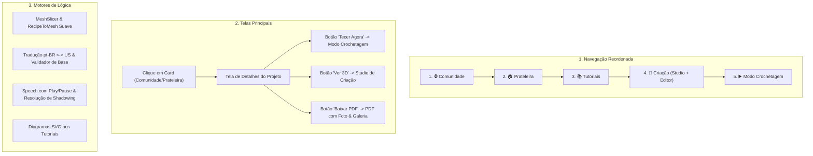

# Plano de Implementação Técnico e Detalhado: Refatoração, Correções e Expansão de UX 🧶✨

Este documento consolida o plano de engenharia aprofundado para a execução completa das correções visuais, motor 3D, parsers, modo crochetagem, exportação em PDF, tutoriais ilustrados e login/perfis, refletindo as decisões alinhadas no `/grill-me`.

---

## 1. Goal Description

Elevar a aplicação ao estado de maturidade de produto, corrigindo gargalos de usabilidade e implementando os fluxos completos:
1. **Nova Hierarquia de Navegação**:
   - `1. 🌐 Comunidade` (Home / Vitrine Inicial de Inspiração)
   - `2. 🏠 Prateleira` (Meus Projetos, Compartilhados Comigo e Favoritos)
   - `3. 📚 Tutoriais` (Dicionário de Pontos Ilustrado com SVGs e Guia de Fios/Agulhas)
   - `4. 🎨 Criação` (Hub unificado contendo o **Studio 3D** e o **Editor de Receita**)
   - `5. ▶️ Modo Crochetagem` (Live Tracker com Play/Pause, visão de todas as partes e badges de pontos)
2. **Tela Dedicada de Apresentação de Receitas (`ProjectDetailView`)**: Abrir ao clicar em qualquer card com foto grande, materiais detalhados, ações rápidas e receita completa formatada.
3. **Modo Crochetagem Hands-Free Controlado**: Barra com Play/Pause explícito (nunca fala sozinho), layout com a receita inteira de todas as partes do amigurumi e badges clicáveis dos pontos da volta com popovers de tutoriais.
4. **Motor 3D Orgânico & Low-Poly Cartunesco**: Eliminar bicos cônicos e piões pontudos no anel mágico, gerando formas suaves e anatômicas com textura têxtil sutil e aconchegante.
5. **Editor pt-BR $\leftrightarrow$ US com Tradução Automática**: Tradução léxica e sintática em tempo real entre termos brasileiros e americanos, e correção do validador matemático de pontos de base.
6. **Tutoriais com Ilustrações Vetoriais SVG Passo a Passo**: Diagramas gráficos de agulha e laçadas para destros e canhotos e símbolos internacionais.
7. **Contraste Visual Acessível (WCAG AA)**: Eliminar textos invisíveis no Dark Mode e corrigir contadores negativos de pontos.
8. **Exportação de PDF Estilo Editorial/Revista em Alta Resolução**: Capa editorial com render 3D em alta resolução, galeria multi-ângulos das partes, ficha técnica de materiais com consumo e receita diagramada com checkboxes para impressão.
9. **Autenticação Fluida e Perfis Públicos de Artesãos**: Modal de login/cadastro rápido com múltiplos perfis no IndexedDB e páginas de perfil público com projetos e botão de seguir.

---

## 2. User Review Required

> [!IMPORTANT]
> **Ordem Definitiva da Barra de Navegação:**
> `1. 🌐 Comunidade` $\rightarrow$ `2. 🏠 Prateleira` $\rightarrow$ `3. 📚 Tutoriais` $\rightarrow$ `4. 🎨 Criação` $\rightarrow$ `5. ▶️ Modo Crochetagem`.
> - O acesso à criação é unificado sob uma única aba **Criação**, com alternador no topo entre **Studio 3D** e **Editor de Receita**.
> - Ao clicar em qualquer card (na Comunidade ou na Prateleira), abre a **Tela de Detalhes da Receita**, sem disparar áudio automático.

---

## 3. Open Questions

Nenhuma questão em aberto. Todas as decisões de ordem, design e arquitetura foram acordadas.

---

## 4. Detalhamento Técnico dos Componentes Propostos



---

### Componente 1: Estado Global, Roteamento & Tipos (`src/store` & `src/types`)

#### [MODIFY] `src/types/crochet.ts`
- Atualizar tipo de navegação principal:
  ```typescript
  export type MainTab = 'community' | 'shelf' | 'learn' | 'creation' | 'tracker';
  export type CreationSubTab = 'studio' | 'pattern';
  ```
- Atualizar interface de projeto para suportar galeria multi-ângulos e dados de exibição:
  ```typescript
  export interface CrochetProject {
    // ... campos existentes
    galleryPhotos?: string[]; // Fotos adicionais em diferentes ângulos para o PDF e tela de detalhes
    totalStitchesEstimated?: number;
  }
  ```
- Adicionar estrutura de etapas ilustradas para tutoriais:
  ```typescript
  export interface StitchTutorialStep {
    stepNumber: number;
    title: string;
    description: string;
    svgIllustration: string; // SVG vetorial responsivo
  }
  ```

#### [MODIFY] `src/store/useCrochetStore.ts`
- Inicializar `viewTab: 'community'` como padrão.
- Adicionar estados reativos:
  - `selectedProjectDetailId: string | null` (controla se a tela de detalhes está aberta).
  - `creationSubTab: CreationSubTab` (`'studio'` ou `'pattern'`).
  - `trackerIsPlaying: boolean` (padrão: `false`, impedindo que a voz comece falando sozinha).
- Ações:
  - `setSelectedProjectDetailId: (id: string | null) => void`
  - `setCreationSubTab: (subTab: CreationSubTab) => void`
  - `setTrackerIsPlaying: (playing: boolean) => void`

---

### Componente 2: Navbar & Layout Principal (`src/components/layout` & `src/App.tsx`)

#### [MODIFY] `src/components/layout/Navbar.tsx`
- Reordenar botões da barra superior:
  1. **Comunidade** (`community`): Ícone de Globo / Pessoas.
  2. **Prateleira** (`shelf`): Ícone de Pasta / Estante.
  3. **Tutoriais** (`learn`): Ícone de Livro / Dicionário.
  4. **Criação** (`creation`): Ícone de Varinha / Paleta de Criação.
  5. **Modo Crochetagem** (`tracker`): Ícone de Play / Agulha de Crochê.
- Adicionar menu suspenso de perfil no canto superior direito:
  - Foto do artesão ativo com indicador de status online;
  - Opções: "Meu Perfil", "Alternar Conta / Login", "Sair".

#### [MODIFY] `src/App.tsx`
- Gerenciamento condicional:
  - Se `selectedProjectDetailId !== null`, renderiza o componente `ProjectDetailView`.
  - Se `viewTab === 'creation'`, exibe no topo o alternador entre `Studio 3D` e `Editor de Receita`.
  - Renderiza o novo `AuthModal` para gestão de login.

---

### Componente 3: Tela Dedicada de Detalhes da Receita (`src/components/project`)

#### [NEW] `src/components/project/ProjectDetailView.tsx`
- Uma página editorial imersiva e completa:
  - **Barra de Topo**: Botão `← Voltar para Galeria / Prateleira`.
  - **Hero de Apresentação**:
    - Foto grande de capa do item / amigurumi em alta definição.
    - Badges elegantes: Categoria (`Amigurumi`), Dificuldade (`Iniciante/Intermediário`), Tempo Estimado (`~4 horas`), e contagem total de carreiras e pontos (`🧶 512 pontos`).
  - **Card do Criador**:
    - Avatar do designer (clicável, abre seu Perfil Público), nome, `@handle`, bio e botão funcional de **"Seguir Artesão"**.
  - **Ficha Técnica de Materiais & Ingredientes**:
    - Fios: marcas sugeridas, cores, tex, diâmetro e consumo calculado em metros e gramas por cor.
    - Agulhas: numeração recomendada em milímetros e padrão US.
    - Acessórios: olhos com trava de segurança de X mm, fibra siliconada de enchimento, agulha de tapeçaria.
  - **Painel de Ações Rápidas (CTAs)**:
    - 🚀 **"Tecer no Modo Crochetagem"**: Configura o projeto ativo e abre o Live Tracker diretamente.
    - 🧶 **"Abrir no Studio 3D"**: Abre o projeto na tela de modelagem 3D.
    - 📄 **"Baixar Receita em PDF"**: Gera e baixa o PDF profissional com fotos e materiais.
  - **Receita Completa Formatada**:
    - Todas as partes do modelo (`Cabeça`, `Corpo`, `Orelhas`) listadas com suas carreiras organizadas e numeradas de forma legível.
  - **Seção "Feito pela Comunidade"**:
    - Mural com fotos reais postadas por outros artesãos que teceram aquela receita.

---

### Componente 4: Modo Crochetagem Hands-Free (`src/components/tracker`)

#### [MODIFY] `src/components/tracker/LiveTrackerView.tsx`
- **Controle de Play / Pause e Inicialização**:
  - Adicionar barra superior de controle com botão destacado de **Play / Pause**:
    - No estado `Pausado` (padrão ao entrar): nenhuma voz fala automaticamente. O usuário tem tempo de se acomodar, pegar a agulha e o fio.
    - Ao clicar em `Play` (ou pressionar Barra de Espaço): o sistema emite um bip de ativação e dita a carreira e ponto atual.
  - Indicador visual animado de pulso indicando quando a escuta do microfone e a fala estão ativas.
- **Layout Dividido (Split-Screen)**:
  - **Centro**: Painel da Carreira Ativa com tipografia gigante de alto contraste, contador de pontos executados vs total, e mini-mapa 3D com a carreira física iluminada em amarelo contrastante.
  - **Barra Lateral Direita**: Árvore com a receita inteira de todas as partes do amigurumi. O usuário pode acompanhar em que ponto está do projeto como um todo e clicar em qualquer carreira para pular para ela.
- **Badges Clicáveis dos Pontos da Volta**:
  - O sistema analisa os pontos presentes na instrução da volta (ex: `pb`, `aum`, `dim_inv`, `corr`) e renderiza botões rápidos `[Ponto Baixo]`, `[Aumento]`.
  - Ao clicar na badge, abre o modal do tutorial com o diagrama SVG correspondente.

#### [MODIFY] `src/components/tracker/StitchDetailModal.tsx`
- Corrigir contraste de cores: eliminar textos verde-claros em fundo branco. Utilizar fundo escuro com bordas âmbar/terracota e tipografia branca nítida.
- Renderizar a ilustração vetorial SVG da laçada.

---

### Componente 5: Motor 3D & Geometria Suave Low-Poly Cartunesca (`src/core/engine`)

#### [MODIFY] `src/core/engine/RecipeToMesh.ts`
- **Eliminação de Pontas Cônicas / Bicos nos Anéis Mágicos**:
  - O algoritmo anterior utilizava uma interpolação linear simples que criava cones afunilados com pontas pontiagudas nos polos.
  - Nova modelagem geométrica:
    - O raio da carreira $r(y)$ é calculado com base em uma função de perfil esferoidal suave:
      $$r(\phi) = R \cdot \sin(\phi), \quad y(\phi) = -H \cdot \cos(\phi), \quad \phi \in [0, \pi]$$
    - No anel mágico ($\text{Carr } 1$), a tampa é fechada com um vértice polar central arredondado e triângulos em leque (*fan triangulation*), eliminando qualquer bico cônico.
- **Adaptação para Estilo Low-Poly Cartunesco Aconchegante**:
  - Segmentação angular limpa ($24$ a $32$ segmentos), faces com normais suaves e iluminação de estúdio difusa.

#### [MODIFY] `src/core/engine/CrochetShaderMaterial.ts`
- Reduzir a amplitude de perturbação procedural (`tactileRelief` ajustado de $1.2$ para $0.25$), gerando uma textura têxtil agradável e tátil sem distorcer os polígonos da malha.

#### [MODIFY] `src/data/presetProjects.ts`
- Reestruturar as peças dos presets para que possuam formas anatômicas harmoniosas:
  - **Coração de Crochê**: 2 cúpulas arredondadas superiores que se fundem em um corpo cônico suave abaulado.
  - **Polvo Amigurumi**: Cabeça esférica perfeita com tentáculos ondulados saindo da base.
  - **Gorro Beanie**: Domo hemisférico com dobra estruturada na borda.
  - **Bolsa Boho**: Corpo cilíndrico com base arredondada e alças arqueadas.

---

### Componente 6: Editor pt-BR $\leftrightarrow$ US & Validador de Pontos (`src/core/parser`)

#### [MODIFY] `src/core/parser/PatternValidator.ts`
- **Correção da Contagem de Pontos de Base**:
  - O validador anterior multiplicava incorretamente a contagem interna de repetições, gerando mensagens absurdas de que "a carreira requeria 27 pontos para uma base de 2".
  - Nova lógica precisa:
    ```typescript
    // Para cada passo da carreira:
    // pb: consome 1 da base, gera 1 no final
    // aum: consome 1 da base, gera 2 no final
    // dim / dim_inv: consome 2 da base, gera 1 no final
    // [1 pb, 1 aum] x 6:
    //   Pontos da base por repetição = 1 (do pb) + 1 (do aum) = 2 pontos da base
    //   Total consumido = 2 * 6 = 12 pontos da base!
    //   Total gerado = (1 + 2) * 6 = 18 pontos finais!
    ```
  - Se a carreira anterior tinha 12 pontos e esta consome 12, a validação é **100% perfeita** sem emitir nenhum aviso falso!

#### [MODIFY] `src/components/pattern/PatternTextEditor.tsx`
- Adicionar conversor bidirecional automático ao alternar o seletor `Português (pt-BR)` vs `Inglês (US)`:
  - Dicionário de conversão léxica e estrutural:
    - `Carr` $\leftrightarrow$ `Rnd`
    - `pb` $\leftrightarrow$ `sc`
    - `pa` $\leftrightarrow$ `dc`
    - `mpa` $\leftrightarrow$ `hdc`
    - `pbx` $\leftrightarrow$ `sl st`
    - `aum` $\leftrightarrow$ `inc`
    - `dim` $\leftrightarrow$ `dec`
    - `dim_inv` $\leftrightarrow$ `inv dec`
    - `anel mágico` / `am` $\leftrightarrow$ `magic ring` / `mr`
    - `no anel mágico` $\leftrightarrow$ `in magic ring`
    - `em toda a volta` $\leftrightarrow$ `around`
    - `pts` $\leftrightarrow$ `sts`
  - Ao clicar no botão `Inglês (US)`, o texto em português é traduzido instantaneamente para termos US válidos, e vice-versa.

---

### Componente 7: Dicionário de Tutoriais com Ilustrações Vetoriais SVG (`src/data` & `src/components/learn`)

#### [MODIFY] `src/data/tutorialDatabase.ts`
- Implementar diagramas vetoriais SVG inline estilizados e responsivos para cada ponto fundamental:
  - **Anel Mágico (`am` / `mr`)**: Círculo de fio com laçada cruzada e agulha puxando o nó corredio.
  - **Correntinha (`corr` / `ch`)**: Agulha laçando o fio e passando por dentro do laço anterior.
  - **Ponto Baixo (`pb` / `sc`)**: Agulha inserindo nas duas alças da base, laçando e puxando com 2 laçadas na agulha.
  - **Ponto Alto (`pa` / `dc`)**: Laçada prévia na agulha antes da inserção e arremate em duas etapas.
  - **Aumento (`aum` / `inc`)**: Dois pontos baixos sendo tecidos no exato mesmo ponto da carreira de base.
  - **Diminuição Invisível (`dim_inv` / `inv dec`)**: Agulha inserindo apenas nas alças da frente (*front loops only*) de dois pontos consecutivos.
- Suporte a espelhamento horizontal automático para artesãos **Canhotos** (`transform: scaleX(-1)` no SVG).
- Símbolo internacional oficial em badge destacada (ex: `+` ou `×` para ponto baixo, `T` para meio ponto alto).

#### [MODIFY] `src/components/learn/StitchDictionary.tsx`
- Renderizar os diagramas SVG em cada card de ponto.
- Corrigir o contraste de todas as caixas de dicas ("Dica de Mestre") e passos textuais.

---

### Componente 8: Contraste do Front-End & Correções na Prateleira (`src/components/shelf`)

#### [MODIFY] `src/components/shelf/ProjectCard.tsx`
- Substituir `~{totalStitches} pontos` por `🧶 {totalStitches} pontos` em badge com fundo e cor destacados, eliminando o caractere de til que se assemelhava a um sinal de menos.
- Ao clicar no card, invocar `setSelectedProjectDetailId(project.id)` abrindo a `ProjectDetailView`.

#### [MODIFY] `src/components/community/CommunityProjectCard.tsx`
- Ao clicar no card comunitário, invocar `setSelectedProjectDetailId(project.id)`.

#### [MODIFY] `src/components/community/CommunityGalleryView.tsx`
- Adicionar banner de boas-vindas acolhedor no topo da aba inicial.
- Carrossel com fotos dos **Artesãos em Destaque** com botão rápido para seguir.

---

### Componente 9: Exportação em PDF com Fotos e Galeria Multi-Ângulos (`src/core/export/PdfExporter.ts`)

> [!NOTE]
> **Detalhamento Aprofundado da Arquitetura do PDF:**
> A geração de PDF será completamente reestruturada para produzir um documento no padrão de editoras profissionais de revistas de artesanato (como Círculo, Coats Corrente e editoras internacionais de amigurumi).

#### Arquitetura de Diagramação Multi-Páginas no jsPDF:

```
PDF Document (Formato A4 - 210 x 297 mm)
│
├── Página 1: Capa Editorial & Ficha Técnica
│   ├── Faixa Superior: Logo "Crochê 3D", Título da Receita, Categoria & Dificuldade
│   ├── Imagem Principal: Foto em alta resolução do amigurumi com moldura e sombra suave
│   ├── Box Lateral/Inferior: Ficha de Materiais detalhada
│   │   ├── Fios: marcas, cores, tex, diâmetro e consumo (metros e gramas)
│   │   ├── Agulhas recomendadas (mm e US)
│   │   └── Acessórios (olhos com trava, enchimento, agulha de tapeçaria)
│   ├── Dimensões Finais da Peça (largura x altura em cm)
│   ├── Tabela de Abreviações utilizadas especificamente nesta receita
│   └── Box do Designer: Nome do autor, @handle, licença de uso e QR Code para o app web
│
└── Página 2+: Instruções de Execução & Galeria Multi-Ângulos
    ├── Galeria de Fotos Multi-Ângulos: Grid com fotos frontal, lateral e detalhes de costura
    ├── Seção de Montagem: Ordem recomendada de costura dos membros
    └── Tabela Estruturada de Carreiras por Partes (Cabeça, Corpo, etc.):
        ├── Coluna 1: Número da Carreira
        ├── Coluna 2: Instruções passo a passo da volta
        ├── Coluna 3: Contagem de pontos final
        └── Coluna 4: Checkbox de marcação [ ] (para o artesão marcar a lápis após imprimir)
```

#### Implementação de Renderização de Imagens no jsPDF:
- **Captura Dinâmica do Snapshot 3D**:
  Se o usuário estiver visualizando o modelo no Studio, o canvas do Three.js é renderizado com fundo branco limpo e capturado via `renderer.domElement.toDataURL('image/jpeg', 0.95)`.
- **Fallback de Foto de Capa**:
  Se o projeto tiver uma foto de capa configurada (URL ou base64 dos presets), a imagem é pré-carregada e convertida em canvas para inclusão com `doc.addImage(imgData, 'JPEG', x, y, width, height)`.
- **Controle de Quebra de Página Inteligente**:
  O motor calcula a altura disponível em cada página e insere quebras automáticas (`doc.addPage()`), garantindo que uma parte da receita (ex: "Braços") nunca seja cortada no meio de forma deselegante.
- **Rodapé Padronizado**:
  Numeração de página `Página X de Y`, créditos imutáveis do designer e termos de licença em todas as páginas.

---

### Componente 10: Autenticação Fluida e Perfis Públicos (`src/components/auth` & `src/components/profile`)

#### [NEW] `src/components/auth/AuthModal.tsx`
- Modal interativo para autenticação sem atritos:
  - **Aba "Entrar / Alternar Perfil"**: Lista os perfis de artesãos já cadastrados no IndexedDB do navegador. O usuário clica em um perfil e entra instantaneamente com 1 clique!
  - **Aba "Criar Novo Perfil"**: Formulário simples com:
    - Nome do Artesão (ex: "Clara Amigurumis")
    - `@handle` exclusivo (ex: `@clara_croche`)
    - Seletor de Avatar / Upload de Foto
    - Biografia
    - Mão Dominante (Destro / Canhoto)
    - Nível de Experiência (Iniciante, Intermediário, Avançado)
  - Os dados são salvos na tabela `profiles` do Dexie.js e ativam a sessão do usuário.

#### [MODIFY] `src/components/community/PublicArtisanProfileModal.tsx`
- Ao clicar no avatar ou nome de qualquer artesão na Comunidade ou na tela de detalhes:
  - Abre a página pública do artesão:
    - Foto grande de perfil e banner;
    - Nome, `@handle`, bio e links sociais;
    - Contadores de estatísticas: Projetos publicados, Seguidores, e Total de peças tecidas pela comunidade (`makes`);
    - Botão **"Seguir Artesão"** interativo que incrementa e salva no `useSocialStore`;
    - Grade com todos os projetos públicos cadastrados daquele criador.

---

## 5. Plano de Verificação

### Testes Automatizados (Vitest)
Executar a suíte de testes unitários para validar a correção matemática da validação de base e os parsers:
```powershell
npm test -- --run
```
Garantir compilação limpa sem erros de TypeScript:
```powershell
npm run build
```

### Roteiro de Verificação Manual
1. **Navegação**:
   - Abrir `http://localhost:5173`. Confirmar que a aplicação abre diretamente na aba **Comunidade** (`1. Comunidade -> 2. Prateleira -> 3. Tutoriais -> 4. Criação -> 5. Modo Crochetagem`).
   - Clicar na aba **Criação** e alternar entre **Studio 3D** e **Editor de Receita**.
2. **Tela de Detalhes da Receita**:
   - Na Comunidade ou Prateleira, clicar em um card (ex: Polvo Amigurumi).
   - Verificar se a página dedicada abre com a foto grande, ficha de materiais, botões de ação e receita completa.
   - Clicar no botão "Voltar" e conferir o retorno para a tela anterior.
3. **Modo Crochetagem**:
   - Clicar em "Tecer no Modo Crochetagem" na tela de detalhes.
   - Confirmar que o áudio NÃO começa falando sozinho.
   - Clicar no botão `Play` para iniciar a narração.
   - Verificar a barra lateral com todas as partes e carreiras do amigurumi.
   - Clicar na badge de um ponto da volta (ex: `pb` ou `aum`) e confirmar a abertura do tutorial com ilustração SVG.
4. **Visual 3D**:
   - No Studio 3D, conferir os modelos 3D dos amigurumis. Confirmar que não existem mais bicos cônicos ("piões"), e que as formas estão arredondadas, suaves e no estilo low-poly cartunesco aconchegante.
5. **Editor de Receita & Validação**:
   - Alternar entre `Português (pt-BR)` e `Inglês (US)`. Confirmar que o texto da receita é traduzido automaticamente (`Carr` <-> `Rnd`, `pb` <-> `sc`, `aum` <-> `inc`, etc.).
   - Verificar que os alertas errados de pontos da base sumiram.
6. **Tutoriais & SVGs**:
   - Acessar a aba Tutoriais. Verificar os diagramas vetoriais SVG passo a passo em cada ponto.
   - Alternar para "Canhoto" e conferir o espelhamento das ilustrações.
7. **Contraste & Cores**:
   - Inspecionar a interface em Dark Mode: checar se os textos de "Dica de Mestre" estão perfeitamente legíveis, se os inputs têm bordas e textos nítidos, e se o contador de pontos na Prateleira exibe `🧶 512 pontos` sem parecer um número negativo.
8. **Exportação de PDF**:
   - Clicar em "Baixar PDF" e abrir o arquivo baixado. Confirmar a presença da foto de capa em alta definição, ficha de materiais, abreviações e receita organizada com checkboxes.
9. **Login e Perfis Públicos**:
   - No menu superior direito, clicar em "Alternar Conta / Login" e criar um novo perfil.
   - Na Comunidade, clicar no perfil de outro artesão e testar o botão "Seguir Artesão".
