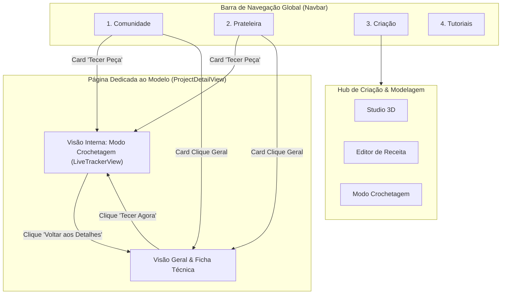

# Plano de Implementação: Reorganização de Abas & Centralização do Modo Crochetagem

Este documento estabelece o plano técnico completo para reorganizar a barra de navegação global e contextualizar o **Modo Crochetagem** exclusivamente dentro de dois locais de alto valor operacional:
1. No **Hub de Criação & Modelagem** (como a 3ª sub-aba de trabalho).
2. Na **Página Dedicada ao Modelo** ([`ProjectDetailView`](file:///c:/Users/ayrto/Documents/antigravity/crochet-3d/src/components/project/ProjectDetailView.tsx)) como visão interna de tecelagem guiada.

---

## 🎯 Objetivo & Visão Geral

- **Remover a aba avulsa global:** Retirar *"Modo Crochetagem"* da barra de navegação superior e mobile, onde se comportava como uma aba solta sem modelo claramente pré-definido pelo usuário.
- **Estabelecer a nova ordem estrita das abas:**
  1. **Comunidade** (`community`)
  2. **Prateleira** (`shelf`)
  3. **Criação** (`creation`)
  4. **Tutoriais** (`learn`)
- **Integrar o Modo Crochetagem no Hub de Criação:** Adicionar `[Modo Crochetagem]` como 3ª sub-aba junto a `[Studio 3D]` e `[Editor de Receita]`.
- **Integrar o Modo Crochetagem na Página do Modelo:** Permitir que, ao clicar em *"Tecer Agora no Modo Crochetagem"*, o usuário entre no tracker interativo sem sair do contexto do modelo, dispondo de um botão claro `← Voltar aos Detalhes do Projeto`.
- **Redirecionamento Inteligente de Cards:** Ao acionar *"Tecer Peça"* nos cards da vitrine ou prateleira, o app abre diretamente a página dedicada do projeto no Modo Crochetagem.

---

## 🔄 Fluxo de Navegação (Arquitetura)



---

## 🔍 Revisão do Usuário & Alinhamentos Prévios

> [!NOTE]
> Todos os ramos de decisão foram previamente refinados e validados na sessão `/grill-me`:
> 1. Na **Página Dedicada ao Modelo**, a alternância ocorre via botão *"Tecer Agora"* que substitui o conteúdo pela interface do tracker, mantendo botão `← Voltar aos Detalhes do Projeto`.
> 2. No **Hub de Criação**, o tracker é adicionado como uma 3ª sub-aba horizontal no cabeçalho: `[Studio 3D] [Editor de Receita] [Modo Crochetagem]`.
> 3. Nos **Cards de Projetos**, o atalho *"Tecer Peça"* abre a Página Dedicada ao Modelo já em Modo Crochetagem.

---

## 🛠️ Mudanças Propostas no Código

### 1. Tipos Globais & Estado Central (Zustand)

#### [MODIFY] [`src/types/crochet.ts`](file:///c:/Users/ayrto/Documents/antigravity/crochet-3d/src/types/crochet.ts)
- Atualizar a união `MainTab` para conter estritamente as 4 abas solicitadas.
- Expandir `CreationSubTab` para incluir `'tracker'`.

```ts
// Antes:
export type MainTab = 'community' | 'shelf' | 'learn' | 'creation' | 'tracker';
export type CreationSubTab = 'studio' | 'pattern';

// Depois:
export type MainTab = 'community' | 'shelf' | 'creation' | 'learn';
export type CreationSubTab = 'studio' | 'pattern' | 'tracker';
```

---

#### [MODIFY] [`src/store/useCrochetStore.ts`](file:///c:/Users/ayrto/Documents/antigravity/crochet-3d/src/store/useCrochetStore.ts)
- Adicionar estado `projectDetailInitialMode: 'overview' | 'tracker'`.
- Adicionar ação auxiliar `openProjectInTracker: (projectId: string) => void` para abrir diretamente a página do modelo com o tracker ativo.
- Adicionar ação `setProjectDetailInitialMode: (mode: 'overview' | 'tracker') => void`.

```ts
interface CrochetState {
  // ...
  projectDetailInitialMode: 'overview' | 'tracker';
  setProjectDetailInitialMode: (mode: 'overview' | 'tracker') => void;
  openProjectInTracker: (projectId: string) => void;
  // ...
}

// Na implementação do store:
projectDetailInitialMode: 'overview',
setProjectDetailInitialMode: (projectDetailInitialMode) => set({ projectDetailInitialMode }),
openProjectInTracker: (projectId: string) => {
  const project = get().projects.find((p) => p.id === projectId);
  const activePartId = project?.parts[0]?.id || '';
  set({
    activeProjectId: projectId,
    activePartId,
    selectedProjectDetailId: projectId,
    projectDetailInitialMode: 'tracker',
  });
},
```

---

### 2. Interface da Navbar

#### [MODIFY] [`src/components/layout/Navbar.tsx`](file:///c:/Users/ayrto/Documents/antigravity/crochet-3d/src/components/layout/Navbar.tsx)
- Reorganizar a lista `navItems` para remover `'tracker'` e aplicar a ordem requerida:
  1. Comunidade (`community`)
  2. Prateleira (`shelf`)
  3. Criação (`creation`)
  4. Tutoriais (`learn`)
- Atualizar comentários e rótulos para manter a integridade da documentação.

```tsx
const navItems: { id: MainTab; label: string; icon: React.ReactNode }[] = [
  { id: 'community', label: 'Comunidade', icon: <Users className="w-4 h-4" /> },
  { id: 'shelf', label: 'Prateleira', icon: <FolderHeart className="w-4 h-4" /> },
  { id: 'creation', label: 'Criação', icon: <Box className="w-4 h-4" /> },
  { id: 'learn', label: 'Tutoriais', icon: <BookOpen className="w-4 h-4" /> },
];
```

---

### 3. Integração no Hub de Criação & Estrutura do App

#### [MODIFY] [`src/App.tsx`](file:///c:/Users/ayrto/Documents/antigravity/crochet-3d/src/App.tsx)
- Importar ícone `PlayCircle` de `lucide-react`.
- Reordenar a renderização dos blocos para acompanhar a ordem da Navbar:
  1. `{viewTab === 'community' && <CommunityGalleryView />}`
  2. `{viewTab === 'shelf' && <ProjectShelfView />}`
  3. `{viewTab === 'creation' && ...}`
  4. `{viewTab === 'learn' && ...}`
- No cabeçalho do **Hub de Criação**:
  - Adicionar o botão da 3ª sub-aba: `Modo Crochetagem` com ícone `PlayCircle`.
  - Renderizar `{creationSubTab === 'tracker' && <LiveTrackerView />}`.
- Remover o bloco órfão antigo `{viewTab === 'tracker' && <LiveTrackerView />}`.

```tsx
<div className="flex items-center gap-1 bg-cream-100 dark:bg-stone-900 p-1 rounded-xl border border-cream-200 dark:border-stone-700">
  <button
    onClick={() => setCreationSubTab('studio')}
    className={/* ... */}
  >
    <Box className="w-4 h-4 text-terracotta-500" />
    <span>Studio 3D</span>
  </button>
  <button
    onClick={() => setCreationSubTab('pattern')}
    className={/* ... */}
  >
    <FileText className="w-4 h-4 text-terracotta-500" />
    <span>Editor de Receita</span>
  </button>
  <button
    onClick={() => setCreationSubTab('tracker')}
    className={/* ... */}
  >
    <PlayCircle className="w-4 h-4 text-terracotta-500" />
    <span>Modo Crochetagem</span>
  </button>
</div>

{/* Sub-Aba Studio 3D */}
{creationSubTab === 'studio' && ( ... )}

{/* Sub-Aba Editor de Receitas */}
{creationSubTab === 'pattern' && ( ... )}

{/* Sub-Aba Modo Crochetagem */}
{creationSubTab === 'tracker' && <LiveTrackerView />}
```

---

### 4. Página Dedicada ao Modelo

#### [MODIFY] [`src/components/project/ProjectDetailView.tsx`](file:///c:/Users/ayrto/Documents/antigravity/crochet-3d/src/components/project/ProjectDetailView.tsx)
- Importar [`LiveTrackerView`](file:///c:/Users/ayrto/Documents/antigravity/crochet-3d/src/components/tracker/LiveTrackerView.tsx).
- Usar `projectDetailInitialMode` e `setProjectDetailInitialMode` do store.
- Controlar o estado `isCrocheting` (inicializado com `projectDetailInitialMode === 'tracker'`).
- Ao clicar no botão *"Tecer Agora no Modo Crochetagem"*:
  - Atualizar `setActiveProjectId(project.id)`.
  - Ativar `setIsCrocheting(true)`.
- Se `isCrocheting === true`:
  - Renderizar barra superior com botão `← Voltar aos Detalhes do Projeto` (que chama `setIsCrocheting(false)` e `setProjectDetailInitialMode('overview')`).
  - Renderizar `<LiveTrackerView />`.
- Ao clicar em *"Voltar para a Galeria"* no modo visão geral:
  - Limpar `selectedProjectDetailId` e restaurar `setProjectDetailInitialMode('overview')`.

```tsx
if (isCrocheting) {
  return (
    <div className="max-w-6xl mx-auto space-y-6 animate-fade-in pb-16">
      <div className="flex items-center justify-between">
        <button
          onClick={() => {
            setIsCrocheting(false);
            setProjectDetailInitialMode('overview');
          }}
          className="flex items-center gap-2 px-3.5 py-2 rounded-xl border border-cream-300 dark:border-stone-700 bg-white dark:bg-stone-800 text-stone-700 dark:text-stone-300 hover:bg-cream-100 dark:hover:bg-stone-700 text-xs font-bold transition-all shadow-sm"
        >
          <ArrowLeft className="w-4 h-4 text-terracotta-500" />
          <span>Voltar aos Detalhes do Projeto ({project.title})</span>
        </button>
      </div>

      <LiveTrackerView />
    </div>
  );
}
```

---

### 5. Atualização dos Cards de Ação Rápida

#### [MODIFY] [`src/components/community/CommunityProjectCard.tsx`](file:///c:/Users/ayrto/Documents/antigravity/crochet-3d/src/components/community/CommunityProjectCard.tsx)
- No método `handleOpenTracker`: invocar `openProjectInTracker(project.id)` ao invés de definir `viewTab('tracker')`.

#### [MODIFY] [`src/components/shelf/ProjectCard.tsx`](file:///c:/Users/ayrto/Documents/antigravity/crochet-3d/src/components/shelf/ProjectCard.tsx)
- No método `handleOpenTracker`: invocar `openProjectInTracker(project.id)`.

#### [MODIFY] [`src/components/shelf/SharedWithMeTab.tsx`](file:///c:/Users/ayrto/Documents/antigravity/crochet-3d/src/components/shelf/SharedWithMeTab.tsx)
- No resgate de token (`onSuccess`): invocar `openProjectInTracker(id)`.

---

## 🧪 Plano de Verificação

### 1. Testes Automatizados & Checagem de Tipagem
- Executar `npm test` para garantir que todos os 18 testes unitários (parsers e engine de mesh) continuam passando.
- Executar `npm run build` (`tsc -b && vite build`) para certificar que os novos tipos `MainTab` e `CreationSubTab` foram propagados sem nenhum erro de TypeScript e que o bundle foi gerado com sucesso.

### 2. Verificação Manual de Interface
1. **Navegação Superior:**
   - Verificar se existem apenas 4 abas no desktop e no mobile.
   - Confirmar a ordem exata: `Comunidade` -> `Prateleira` -> `Criação` -> `Tutoriais`.
2. **Hub de Criação:**
   - Clicar na aba `Criação`.
   - Alternar entre `Studio 3D`, `Editor de Receita` e `Modo Crochetagem`.
   - Verificar se o `LiveTrackerView` renderiza perfeitamente com os controles de carreiras, pontos e mini-mapa 3D sincronizados com a peça em modelagem.
3. **Página Dedicada ao Modelo:**
   - Abrir qualquer projeto a partir da Comunidade ou Prateleira.
   - Clicar no botão *"Tecer Agora no Modo Crochetagem"*.
   - Verificar a transição imediata para o tracker dentro da página do projeto.
   - Clicar em *"Voltar aos Detalhes do Projeto"* e confirmar que a ficha técnica, fotos e lista de carreiras reaparecem preservadas.
4. **Atalho dos Cards:**
   - Na Comunidade ou Prateleira, clicar direto em *"Tecer Peça"*.
   - Confirmar que a tela abre direto no tracker daquele modelo específico.
