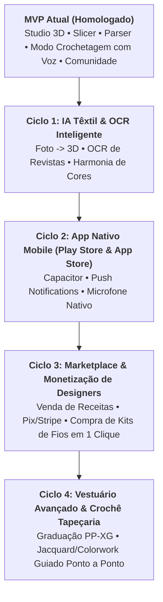

# Roadmap Estratégico de Futuras Implementações: Crochê 3D Interativo 🧶🚀

Este documento estabelece o planejamento estratégico e tecnológico para os próximos ciclos de evolução da plataforma **Crochê 3D Interativo**, organizado em 4 Ciclos de Entrega (*Horizontes Tecnológicos*) baseados nas decisões de engenharia e produto alinhadas.

---

## 🗺️ Visão Panorâmica dos Ciclos

---

## 1. Ciclo 1: Inteligência Artificial Têxtil & OCR Inteligente 🤖📸

> **Objetivo**: Reduzir a barreira de entrada da modelagem, permitindo transformar fotos do mundo real e revistas escaneadas em projetos 3D e receitas digitais com um clique.

### Épicos e Entregas:
1. **Pipeline de OCR Têxtil Híbrido (`RecipeOCRScanner`)**:
   - Leitor local via WebAssembly (Tesseract.js) para transcrição imediata de fotos de livros e cadernos de anotações sem custo de servidor.
   - Pré-processamento de imagem: correção de perspectiva, aumento de contraste e binarização adaptativa para papéis amarelados ou fotos tiradas em ângulos inclinados.
   - Mapeador de símbolos de diagramas circulares para a sintaxe do parser (`CrochetParserPtBr`).
2. **Reconstrução 3D por Visão Multimodal (`ImageToAmigurumi3D`)**:
   - Integração com a API multimodal do **Gemini Vision**: o usuário envia a foto de um amigurumi real ou um esboço 2D desenhado à mão.
   - Decomposição semântica em primitivas: a IA identifica as partes (ex: "Tronco = Cápsula, Cabeça = Esfera, Orelhas = Cones") e as cores dominantes dos fios.
   - Geração automática da árvore de partes no Studio 3D com a receita fatiada correspondente pronta para edição.
3. **Assistente de Harmonia Cromática de Fios (`YarnColorPaletteAI`)**:
   - Sugestor baseado na teoria das cores (tríades, análogas, complementares e pastéis) mapeando automaticamente os códigos hexadecimais para cores de novelos comerciais reais disponíveis nas lojas brasileiras e internacionais.

---

## 2. Ciclo 2: Aplicativo Nativo Mobile (Google Play & Apple App Store) 📱📲

> **Objetivo**: Publicar a experiência de crochê diretamente nos smartphones e tablets de milhões de artesãos através das lojas oficiais de aplicativos.

### Épicos e Entregas:
1. **Empacotamento Nativo com Capacitor / React Native**:
   - Configuração de builds nativos para Android (APK/AAB) e iOS (IPA).
   - Suporte a telas cheias imersivas sem barras de navegação do browser, otimizado para tablets apoiados em suportes de mesa.
2. **Integração de Áudio e Microfone Nativo em Background**:
   - Eliminação das restrições de permissão contínua de microfone da Web Speech API nos navegadores móveis, utilizando os engines de fala nativos do Android (Google Speech Recognition) e iOS (Siri/Speech Framework).
   - Funcionamento do ditado por voz mesmo com a tela bloqueada ou em modo de economia de energia.
3. **Notificações Push e Engajamento Saudável**:
   - Lembretes personalizados (ex: *"Faltam apenas 3 carreiras para você concluir seu Polvo Amigurumi!"*).
   - Alertas ergonométricos de alongamento e pausas para descanso muscular.
4. **Modo 100% Offline com Sincronização em Segundo Plano**:
   - Cache completo de todos os assets 3D e tutoriais para funcionamento em viagens de avião, praia ou sítio.

---

## 3. Ciclo 3: Marketplace de Designers & Monetização de Criadores 🛍️💳

> **Objetivo**: Criar um ecossistema econômico sustentável que empodera criadores de crochê a viverem de sua arte, vendendo suas receitas e facilitando a compra de insumos.

### Épicos e Entregas:
1. **Loja de Receitas Digitais Autoriais**:
   - Designers podem definir o preço de suas receitas (em BRL/USD) ou disponibilizá-las gratuitamente.
   - Compra com 1 clique via **Pix** instantâneo no Brasil e **Cartão de Crédito internacional** via Stripe.
   - Ao comprar, o projeto `.crochet3d` e o PDF em alta definição são desbloqueados na aba "Projetos Adquiridos" na Prateleira do comprador.
2. **Repasse Transparente com Split de Pagamentos**:
   - Split automático de valores (85% a 90% direto para a conta do designer parceiro, retendo taxa operacional mínima para manutenção dos servidores).
   - Painel financeiro do designer com extrato de vendas, receitas mais populares e relatórios de execução pela comunidade.
3. **Integração "Comprar Kit de Fios e Agulhas em 1 Clique"**:
   - Parceria com armarinhos e lojas virtuais de fios: ao abrir qualquer receita, o artesão clica em *"Comprar Kit deste Projeto"* e o carrinho é pré-preenchido exatamente com a quantidade de novelos nas cores certas e a agulha necessária.

---

## 4. Ciclo 4: Vestuário Avançado, Graduação de Tamanhos & Crochê Tapeçaria 👗🎨

> **Objetivo**: Expandir o escopo da plataforma para além dos amigurumis, tornando-se o software definitivo para moda em crochê e técnicas avançadas de tecelagem.

### Épicos e Entregas:
1. **Assistente de Graduação Automática de Tamanhos (Size Grading)**:
   - Resolução da maior dificuldade no crochê de vestuário: redimensionar casacos, blusas, tops e vestidos para diferentes biotipos corporais.
   - O designer cria a peça no tamanho M, insere a tabela de medidas em centímetros (busto, cintura, quadril, comprimento da manga) e o algoritmo recalcula automaticamente as correntinhas iniciais, aumentos e carreiras para os tamanhos **PP, P, M, G, GG e XG**.
2. **Estúdio de Crochê Tapeçaria (Jacquard / Colorwork em 3D)**:
   - Editor em grade de pixels tridimensional onde cada laçada na malha 3D pode ser pintada com cores de fios diferentes.
   - O gerador de receitas dita a troca exata de cor ponto a ponto (ex: *"Carreira 12: 5 pb em Azul, conduzir fio, 3 pb em Branco, 4 pb em Azul"*).
3. **Simulador de Caimento Têxtil (Cloth Physics Simulation)**:
   - Simulação física em GPU do caimento e drapeado do crochê no corpo humano virtual, permitindo avaliar elasticidade e peso antes de tecer a peça.

---

## 5. Matriz de Priorização e Cronograma Estimado

| Ciclo | Tema Central | Complexidade | Valor Agregado para o Usuário | Previsão |
| :---: | :--- | :---: | :---: | :---: |
| **Ciclo 1** | IA Têxtil & OCR Inteligente (Foto $\rightarrow$ 3D) | Média-Alta | ⭐⭐⭐⭐⭐ (Transformador para onboarding) | Trimestre 1 |
| **Ciclo 2** | App Nativo Mobile (Play Store & App Store) | Média | ⭐⭐⭐⭐⭐ (Canal prioritário de artesãos) | Trimestre 2 |
| **Ciclo 3** | Marketplace de Designers & Compra de Kits | Média-Alta | ⭐⭐⭐⭐ (Sustentabilidade e renda para criadores) | Trimestre 3 |
| **Ciclo 4** | Vestuário com Graduação PP-XG & Jacquard | Alta | ⭐⭐⭐⭐ (Abertura para o mercado da moda) | Trimestre 4 |

---

## 6. Governança e Métricas de Sucesso (KPIs)

Para acompanhar o sucesso de cada ciclo do Roadmap:
- **Engajamento no Modo Crochetagem**: Tempo médio diário de execução hands-free por artesão.
- **Taxa de Conversão de Receitas por OCR/IA**: Porcentagem de receitas escaneadas com sucesso sem necessidade de correção manual.
- **Receita Gerada para Designers Parceiros**: Volume bruto de mercadorias (GMV) transacionado no marketplace.
- **Avaliações nas Lojas de Aplicativos**: Meta de $\ge 4.8 \text{ estrelas}$ no Google Play e Apple App Store.
